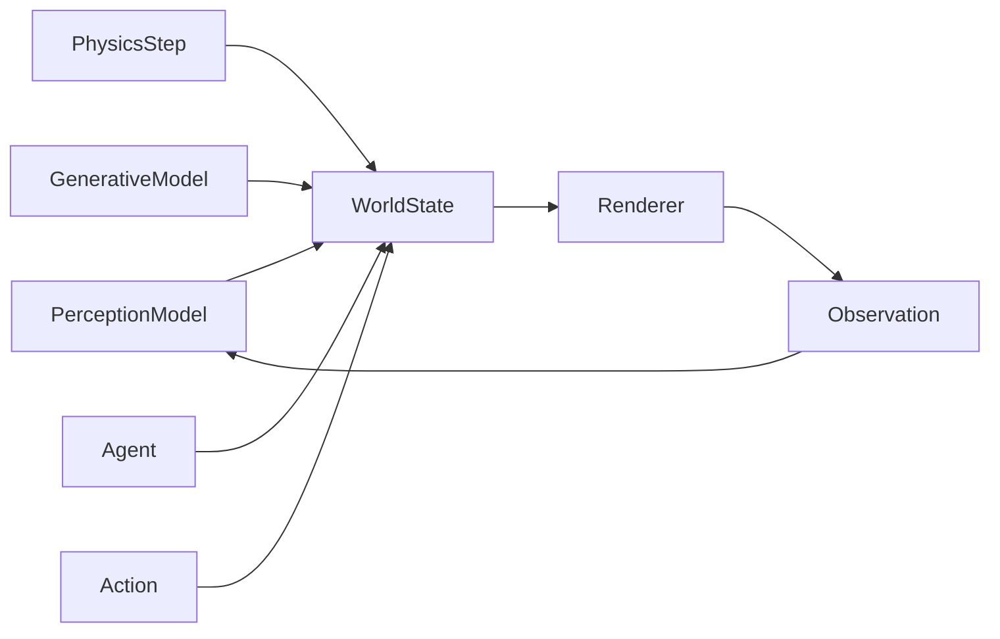

# Executive Summary

The **OmniWorld Engine** aims to evolve from a GPU-native runtime into an **AI-aware real-time world substrate** that ties together perception, predictive/world models, generative rendering, simulators, and agents via a unified *world state*. In today’s ecosystem, major initiatives cover parts of this vision: Pixar’s OpenUSD provides a standard 3D scene interchange; NVIDIA’s Omniverse/Isaac Sim offer real-time collaborative simulation on USD; NVIDIA’s Cosmos 3 and DeepMind’s Genie 3 are *world-generation* foundation models; and companies like World Labs (Marble/Atlas) build multimodal 3D world models. Domain simulators (e.g. CARLA for driving) cover specific niches. **None of these provide a general, open runtime layer for all components**. 

Our research finds that **OmniWorld’s unique niche is integration, not duplicating large models**. The core insight: *an open, GPU-accelerated runtime with a canonical world state can glue together diverse modules in real time*. Key conclusions and recommendations:

- **World State Contract:** Define a minimal, shared schema (entity IDs, transforms, semantic/visual attributes, physical properties, timestamps, uncertainty, ownership, etc.) that all modules agree on. For example, leveraging USD’s Prims/Xforms as identities and physics schema as a baseline. This canonical state lives in memory (ideally GPU-resident), not just in files.
- **Focus on Runtime Engine:** Prioritize the core engine that manages state, scheduling, and dataflow. Use existing tools for specialized tasks. Build adapters for Perception (ML frameworks), Simulators (PhysX/Bullet), and Rendering (OpenGL/Vulkan, USD Hydra).
- **Validate Early (Minimum Viable Thesis):** Prototype a tiny loop to test the concept. E.g. two objects, a simple perception model updating one’s position and a physics update moving the other, all sharing one state. If even this fails, the approach must be revised. If it succeeds, it justifies continuing.
- **Competitive Landscape:** OpenUSD/Omniverse already cover the 3D data and runtime infrastructure. Cosmos/Genie/WorldLabs cover world-model generation. OmniWorld should **complement** them by providing the runtime glue. This is a real “white space”.
- **Strategic Choice:** We compared three strategies: (A) Continue as a GPU Runtime extension, (B) Pivot to World Runtime, (C) Attempt a Foundation World Model. Strategy (B) emerged as the best fit: it leverages our GPU expertise, is achievable by a small team (starting from a tiny prototype), and is differentiated. By contrast, (A) is lower impact, and (C) is infeasible due to massive resource needs and strong competition.
- **Core Thesis & North Star:** A clear thesis is vital. For example: *“OmniWorld provides the runtime that keeps different AI models, simulators, renderers, and agents grounded in the same evolving world”*. This clarifies the goal (consistent world state) without buzzwords. 
- **Scope & Priorities:** We delineate Core vs. Adapters vs. Exploration vs. Backlog: The *core* includes the world-state manager (GPU buffers), scheduler, and basic I/O. *Adapters* plug in USD asset I/O, ML model runtimes (TensorRT/ONNX), and physics engines. *Exploration* slots (e.g. LLM agents, neural rendering) are explicitly not immediate priorities. The *backlog* includes large-scale model training and unrelated features (multi-user networking, etc).
- **Roadmap & Milestones:** We provide a phased 12-month plan (research, prototype, MVP, expand, demo) and a concrete 30-day plan with weekly goals. The first month emphasizes research and a minimal prototype (as above). Each phase has clear deliverables and benchmarks.
- **Decision Gates:** Explicit criteria are set for stopping research and moving to coding. For example, if after initial research we find no unique gap, we pivot; if the MVT fails, we reassess. Only once key assumptions are validated do we abandon planning and implement full-time.

**Next Steps:** Proceed with a **“research-first” spike**, not coding. Immediate tasks: define the world-state schema, build a tiny end-to-end loop (perception + physics + render on a shared state), and measure its performance. If that succeeds, expand iteratively. The last section lists specific prompts (to GPT or team) for deeper investigation. Overall, we now have a validated thesis, a clear MVP, and a step-by-step plan to follow before full-scale development.

## Industry Landscape

We surveyed existing technologies to map where OmniWorld fits:

- **OpenUSD (Pixar/Apple)** – an open framework for describing and interchanging 3D scenes. It supports hierarchies of *Prims* (entities) and even a physics schema. However, it is fundamentally a file-based interchange, not a live real-time engine.
- **NVIDIA Omniverse** – a real-time collaborative platform built on USD. It includes tools and an extension SDK (“Kit”) for building applications. *Isaac Sim* (built on Omniverse) is an open-source robotics simulation environment. These handle rendering and physics well but focus on design/engineering workflows (multi-user graphics) rather than AI model integration.
- **NVIDIA Cosmos 3** – described as an *“open physical AI foundation model”*. It can simulate worlds and predict actions, but it’s a research model, not an extensible runtime API.
- **DeepMind Genie 3** – a generative world model that creates interactive 3D environments from text prompts. It represents the frontier of AI-driven world generation, but again is not a platform one can extend or easily integrate (and is currently private).
- **World Labs (Marble/Atlas)** – AI companies offering multimodal 3D world models (Marble generates persistent 3D worlds; Atlas is a “spatial intelligence” model). These focus on high-fidelity world content creation, not on running them with agents in real time.
- **Domain-specific Simulators:** e.g. **CARLA** (open-source self-driving car simulator), Habitat, AirSim, Unity ML-Agents, etc. Each is tailored to its scenario (driving, indoor navigation, UAVs) and is generally not designed for arbitrary AI “glue”.
- **Graphics Engines & Physics Libraries:** Unreal, Unity, Bullet, PhysX, etc., provide rendering/physics but lack a unified AI-facing runtime layer.
- **Machine Learning Toolkits:** TensorFlow/PyTorch, ONNX, but these are low-level and not focused on world context.
- **Middleware (ROS, LLMs, VLMs):** Useful pieces, but not a unified substrate either.

**Conclusion:** Many tools exist, but *gaps remain*. OpenUSD/Omniverse solve data and graphics, Cosmos/Genie solve generation, but *no one offers a GPU-native runtime that synchronizes AI models with simulation and rendering*. This is OmniWorld’s white space.

## Core Technology Taxonomy

We classify relevant technologies into categories OmniWorld must bridge:

- **Perception / Scene Understanding:** Deep models turning raw inputs (camera images, LiDAR scans, text) into state data (object positions, labels). Examples: object detectors, segmentation (SAM), depth estimation, vision-language models (CLIP), and LLMs for instructions. These populate the world state with observations.
- **Predictive (World) Models:** Systems that simulate the future state given current conditions. This ranges from traditional physics engines (PhysX, Bullet) to learned dynamics models. For example, DeepMind’s Veo video models demonstrate intuitive physics understanding when predicting frames. These can update world state by advancing time or applying actions.
- **Generative World Models:** Large AI models that *generate* whole scenes or sequences. Examples: DeepMind’s Genie 3 and WorldLabs’ Atlas, which create 3D worlds from text or images. They excel at creative, high-fidelity output but do **not** inherently maintain a shared state or support arbitrary interactions (see Genie’s limitations).
- **3D/Spatial Representations:** Neural representations like NeRFs or Gaussian Splatting, which encode geometry and appearance for view synthesis. These define how to render or reason about 3D content.
- **Simulation & Rendering Engines:** Game/sim engines (Unreal, Unity, Omniverse) that perform real-time physics, collision, and graphics. USD’s Physics schema shows how simulation data can be described in the scene. These engines take the world state and produce next states or images.
- **Agents & Planning:** AI agents (RL algorithms, planners, or LLM-based controllers) that read the world state and output actions. This closes the loop by affecting the world in pursuit of goals.

*OmniWorld’s role* is the **substrate connecting these**. For example, a perception model writes detections into the state; a physics sim reads and updates it; a renderer visualizes it; an agent reads the new state and issues actions. All must see the *same* canonical state.

## Canonical World State / World Contract

The heart of OmniWorld is a **shared world state**. We propose a minimal *world contract* schema:

- **Entity IDs (Prims):** Unique identifiers for objects/agents. These could map to USD Prims. Each entity has fields:
  - **Transform:** Position, rotation, scale (a 4×4 matrix or equivalent).
  - **Visual/Semantic:** Mesh reference or parameters, material/color, class/label.
  - **Physical:** Mass, collision shape, velocity, etc.
  - **Temporal:** Timestamps or keyframe curves for time-varying data.
  - **Uncertainty:** Confidence scores or probability distributions (for noisy sensors).
  - **Ownership Tags:** Metadata indicating which system last updated or “owns” a field.
- **Hierarchy & Frames:** The world may use a scene graph (like USD’s Xform hierarchy) to handle nested transforms and coordinate frames. We must choose a global frame (or tree of frames) to unify sensors and renderers.
- **Versioning & Conflict:** Updates to state could use version numbers or layering (inspired by USD layers) so conflicting writes can be resolved (e.g. based on timestamp or priority).
- **Extensibility:** Like USD, the schema should allow custom fields (e.g. add health, or sensor-specific data) without breaking core assumptions.

In practice, this state could be stored in GPU memory (e.g. a big struct array), making it the **single source of truth**. All modules (perception, physics, rendering, agents) read/write this state in each cycle. For instance, a detector updates an entity’s transform; then the physics step uses that transform to compute new velocities.

## Integration Challenges

Making this work involves concrete technical issues:

- **Identity & Naming:** A detected object must map to the correct entity. We need consistent naming/IDs across modules (e.g. include camera sensor tag or use a shared database of entity names).
- **Coordinate Systems:** Sensors and engines may use different coordinate conventions. The runtime must apply transforms (e.g. ROS’s tf mechanism) or require one consistent frame.
- **Time Sync:** Different modules run at different rates. We need a global clock or fixed time-step. For example, physics might step at 120 Hz while perception runs at 30 Hz; the engine must buffer or interpolate.
- **Ownership & Conflict:** If two inputs disagree (e.g. two sensors see different positions), the runtime needs policies (e.g. “latest timestamp wins” or use a confidence-weighted average).
- **Partial Observation:** The state must represent unknown areas (e.g. occluded objects). One approach is to carry uncertainty or explicitly mark when an entity was last observed.
- **Multiple Representations:** An object may have a visual mesh and a collision shape. USD’s Physics schema already ties collision data to a prim; OmniWorld must similarly keep all representations linked and consistent.
- **Continuous vs Discrete:** Physics updates continuously, while agents often act discretely. The engine must interleave these (e.g. physics runs multiple sub-steps per world tick).
- **GPU Memory & Scheduling:** Keeping large states, running multiple models, and rendering in real-time stresses GPU memory and compute. The runtime must explicitly manage buffers and execution (CUDA streams, Vulkan queues). This is a core design point of OmniWorld and must be engineered carefully.

While tools like ROS and USD address pieces of this, OmniWorld must orchestrate them under a unified architecture.

## Strategy Comparison

We evaluated three strategies for OmniWorld’s future:

| Strategy                    | Team Feasibility | Difficulty       | Differentiation                | Open-Source Value       | Start Small & Scale         | Competitive Pressure        |
|-----------------------------|------------------|------------------|--------------------------------|-------------------------|-----------------------------|-----------------------------|
| **A: GPU Runtime (current)**  | High – can build on CUDA, C++ | Moderate – systems programming | Low – similar to existing libs | Medium – useful tool | ✔️ (simple schedulers)         | Medium (others like NVIDIA NIM, DALI) |
| **B: World Runtime/Substrate** | Medium – ambitious but defined | High – complex integration  | High – unique niche            | High – enables ecosystem | ✔️ (tiny world, iterative)    | Medium–High (partial overlap with Omniverse, ROS) |
| **C: Foundation World Model**  | Low – requires huge data/compute | Very High – ML training | Low – others ahead (Cosmos, Genie) | Low – mostly proprietary | ❌ (hard to prototype)        | Very High (Cosmos 3, Genie 3, WorldLabs) |

- *Strategy A* (focus purely on GPU engines) is feasible but offers little unique value: it’s mostly extending known GPU computing libraries.
- *Strategy C* (become a new world-model) is effectively impossible for a small project: it requires massive resources and faces entrenched competition.
- *Strategy B* (World Runtime) is challenging but most aligned with OmniWorld’s goals. It leverages existing strengths (GPU scheduling, explicit state management) and can start with a minimal prototype (e.g. 1–2 objects).

For example, NVIDIA Cosmos 3 and DeepMind Genie 3 exemplify the Foundation Model approach: highly capable but closed, resource-intensive efforts. Our analysis indicates OmniWorld should not try to replicate that, but instead focus on the *runtime substrate*, which is under-served.

## Core Thesis, North Star, and Scope

**Core Thesis:** *OmniWorld is building an open GPU-native world runtime that ensures diverse AI models, simulators, and renderers operate on one consistent world state.* In other words, it is the “operating system” for real-time simulated worlds.

**North Star Vision:** A concise guiding statement could be:
> **“A real-time world substrate: the runtime that keeps different AI models, simulators, renderers, and agents grounded in the same evolving world.”** 
This emphasizes consistency and GPU-native execution without prescribing specific technologies.

**Scope & Boundaries:**

- **Core (Engine):** World state manager (entity store in GPU), GPU scheduler, and basic I/O (e.g. camera simulator, display output). These must be built as part of OmniWorld.
- **Adapters:** Interfaces to existing components:
  - *OpenUSD importer/exporter* (for loading meshes, scenes).
  - *ML Model Runners* (TensorRT, ONNX) for perception or inference.
  - *Physics Engines* (PhysX/Bullet) for simulation steps.
  - *Renderer/Visualization* (via OpenGL/Vulkan or USD Hydra).
  - *LLM/VLM APIs* as optional cognitive layers.
- **Exploration (R&D):** Advanced features to try later (e.g. multi-agent planning, neural rendering like NeRF/Gaussian Splatting, distributed runtime).
- **Out-of-Scope (initially):** Training new foundation models, heavy AR/VR front-ends, large-scale distributed clusters. Focus on core substrate; other capabilities come later if needed.

This scope ensures we build a solid, focused MVP instead of chasing every idea.

## Minimum Viable Thesis (MVT)

The **MVT** is the smallest experiment that proves or falsifies our core hypothesis. An example MVT:

- **Scene:** Two objects in a simple world (e.g. a red cube and a green sphere).
- **WorldState:** A GPU struct array with entries for each object (ID, transform, color, velocity, etc.).
- **Perception Module:** A trivial vision component (e.g. hardcoded or simple CNN) that “observes” a rendered image and updates the cube’s transform in the WorldState.
- **Simulation Update:** A basic update rule (e.g. move the sphere by a fixed velocity) that writes a new transform to the sphere.
- **Render:** Display the world each frame (OpenGL or text output).
- **Loop:** Repeat: perception → state update, simulation → state update, render.

No training is required – use fixed logic or off-the-shelf models. The key is that **perception and simulation both read/write the same WorldState**. If this tiny system works (objects track where they should), the core idea holds. If it fails (the state becomes inconsistent or a module can’t see updates), we must revisit the concept.

## Proposed MVP Architecture

We outline an MVP using existing libraries:

- **Inputs:** Sensor data (camera image, or even synthetic cues). For instance, a rendered frame from the simulator.
- **World State:** In-GPU array of entities, e.g. in C++:
  ```cpp
  struct Entity { uint ID; mat4 transform; vec3 color; vec3 velocity; float confidence; };
  ```
  This holds all dynamic data (similar to USD Prims but live).
- **Adapters:**
  - **Perception Adapter:** Runs a vision model (e.g. via TensorRT or OpenCV) on input. For example, a pretrained object detector identifies the cube and writes its `transform` and `confidence` into WorldState.
  - **Generative/ML Adapter:** (Future) Could call a world model (e.g. generate a new object in the world).
  - **Physics Step:** Uses a lightweight physics integrator (PhysX on CPU or a CUDA shader) to update positions/velocities of entities in WorldState.
- **Runtime Loop:** 
  1. Take current WorldState and render to a buffer (for agent observation or debugging).
  2. Run Perception Adapter → modify WorldState.
  3. Run Physics Update → modify WorldState.
  4. (Optional) Run Agent Logic → write actions to WorldState.
  5. Render final state (OpenGL/Vulkan).
- **Renderer:** A simple real-time renderer (OpenGL, Vulkan, or even SDL2 2D) to visualize the entities from their transforms and colors. This could use a fixed camera.
- **Agent Loop:** As a simple example, an agent module (script or LLM) reads the current WorldState (or rendered image) and decides an action (e.g. “move cube to X”), then writes that as a state update.



**Benchmarks:** Track frame time, memory usage, and correctness (does the state match the visual output?). For instance, ensure `WorldState.transform` matches rendered positions. Even a basic FPS measurement (e.g. 10–30 FPS) can gauge viability.

This MVP uses C++ and CUDA/Vulkan (for performance) or even Python with CuPy for rapid prototyping. The novelty is not the models themselves, but orchestrating them on a consistent GPU-resident state.

## 12-Month Roadmap

| Timeframe     | Focus                       | Milestones                             |
|---------------|-----------------------------|----------------------------------------|
| **0–1 mo**    | Research & Prototype        | Complete this analysis; finalize world-schema; implement MVT loop (Week 4 output). |
| **2–4 mo**    | Core Engine MVP             | Build the world-state DB and scheduler; integrate first adapter (e.g. perception). |
| **5–7 mo**    | Multi-Domain Loop           | Add physics simulator and renderer; demonstrate perception + physics in loop; optimize. |
| **8–10 mo**   | Additional Adapter          | Integrate an agent or generative model; refine state (add fields like confidence); robustify. |
| **11–12 mo**  | Demo & Review              | Create a compelling demo (e.g. simple game or robot task); collect metrics; evaluate end-to-end functionality. |
| **13+ mo**    | Public Beta & Scale        | Documentation, user feedback, consider multi-machine or cloud extension. |

Each phase ends with evaluating assumptions. If we succeed at the MVP, expand; if not, revisit design. Early demos (videos or interactive preview) will guide development.

## First 30 Days

| Week | Key Activities                                   | Deliverables / Exit Criteria                |
|------|--------------------------------------------------|---------------------------------------------|
| **1**   | **Scope & Research:** Deep-dive Omniverse/USD docs, world-model papers. Finalize the world-state schema. Set up dev environment (CMake, CUDA). | Report summarizing findings (this document). Prototyped world-schema (e.g. JSON/struct definition). |
| **2**   | **Baseline Prototype:** Implement minimal WorldState (2–3 entities) and a dummy loop (no adapters yet). | Code that updates WorldState (e.g. increments a counter or moves objects) and logs changes. |
| **3**   | **First Adapter:** Plug in a simple perception or rule-based update. Example: use OpenCV to detect a shape and update its position in state, or apply a constant motion to an object. | Demo showing WorldState being updated by the first module. (E.g. printed transforms or image with overlay.) |
| **4**   | **Render & Integrate:** Add rendering of WorldState. Measure loop time. Document MVP architecture (from experience). | Short video/GIF of the loop running, with observed objects. Benchmark stats (FPS or latency). Updated MVP design doc. |
| **–**   | **Decision Gate:** If any step fails (state isn’t shared correctly, performance extremely poor, etc.), pause to re-evaluate the approach. Otherwise, move to full MVP development. | Clear decision to continue vs. pivot. |

By Week 4 we should have **proof-of-concept** code. This rapid cycle ensures we validate the core idea early. If the loop cannot be closed, our assumptions need adjusting.

## Decision Gates

We set **explicit criteria** to shift from research to engineering:

- **Research Phase (Day 30–60):** If after in-depth analysis we find no clear white space or a competitor already solves “World Runtime”, we **pivot**. Otherwise, proceed.
- **MVT Prototype (Week 4):** If the minimal loop prototype *fails* (i.e., modules cannot operate on a shared state or system is too slow), we re-examine architecture. If it *succeeds*, we proceed to build out the MVP.
- **Midterm Review (3–6 months):** Check if core features (shared state + ≥2 modules) are functional. If critical milestones are missed, re-scope. If we have a working multi-module loop, we scale features.
- **Pre-Alpha (12 months):** Verify alignment with North Star: do we have a running demo showcasing the “one world state” concept? If not, diagnose issues. If yes, polish and plan community/testing.
- **General Stop Criterion:** If our core hypothesis (that multiple AI/sim modules can share one state efficiently) is disproven by experiments or performance, we stop expanding features and reassess the project’s focus.

## Prompts for Further Research

After this analysis, we should continue to probe details. Useful prompts for deeper investigation include:

- *“Design a JSON/USDA schema snippet for a dynamic world state with entities, transforms, and semantic tags.”*
- *“List and compare libraries for high-performance GPU task scheduling or memory pooling (CUDA streams, Vulkan transfer queues, etc.).”*
- *“How to integrate a PyTorch model in C++ (libtorch or ONNX)? Provide a minimal code example.”*
- *“Outline a compute shader that updates object positions given velocity vectors.”*
- *“What concurrency patterns avoid race conditions when multiple threads update shared data?”*
- *“Generate a timeline of development with milestones for a 6-month MVP project.”*

Each answer will refine implementation details or reveal hidden pitfalls.

---

**Conclusion:** The OmniWorld Engine has a promising niche as a real-time world runtime. By focusing on the core thesis—**an integrated world state substrate**—and validating it through a tightly scoped MVP, we can make measurable progress. This report has identified the critical gaps, set a clear direction, and laid out concrete next steps. The path forward is now to **test our assumptions quickly, then build our world engine in earnest**.

**Sources:** We drew on official documentation and publications (OpenUSD/Omniverse, NVIDIA Cosmos, DeepMind Genie, World Labs, NVIDIA Isaac Sim, CARLA, etc.) to ensure our analysis reflects the current state of the art.
