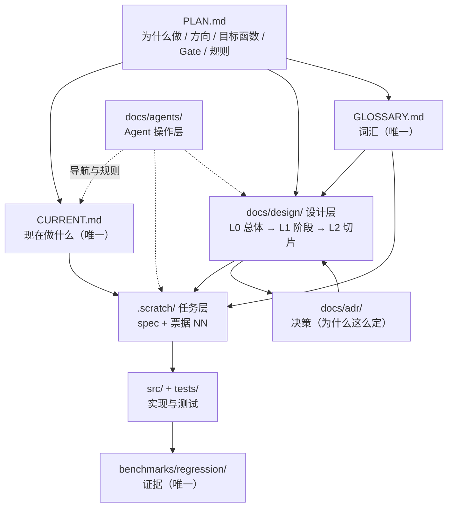
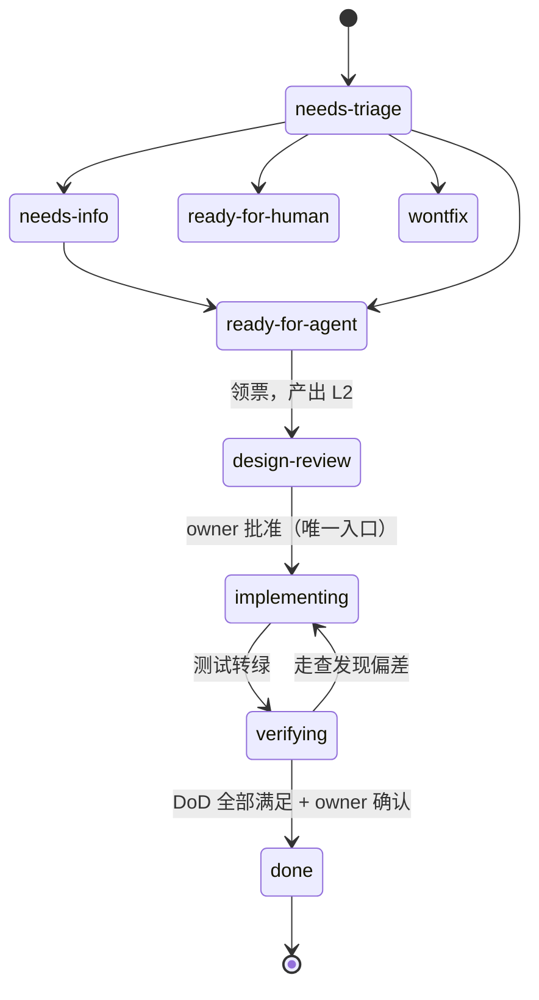

# 工作流使用说明（Workflow Manual）

> **这份文件是什么**：一套**操作手册**——回答四个问题：现在该做什么、怎么做、做完怎么算数、交接给别人怎么接得上。
>
> **这份文件不是什么**：它**不复制权威内容**。定位/目标函数/规则以 [`PLAN.md`](../../PLAN.md) 为准；"现在做什么"以 [`CURRENT.md`](../../CURRENT.md) 为准；契约与架构以 [`docs/design/`](../design/) 为准；决策以 [`docs/adr/`](../adr/) 为准；术语以 [`GLOSSARY.md`](../../GLOSSARY.md) 为准。**一旦本文件与上述权威文件冲突，以权威文件为准**，并把偏差报告给 owner。
>
> **依据**：ADR-0010（白纸共创重建 + 设计先行 + 技能映射）、PLAN §九 操作规则、`AGENTS.md` 工作流约束、`docs/agents/triage-labels.md`（票据状态机）。
>
> **适用范围**：OmniWorld-Engine 单人 owner + 多个 AI 工具（Codex / OpenCode / 本 Agent）在同一仓库协作。所有流程都假设"文档即状态、文件即交接"。

---

## 0. 30 秒速览：我现在该走哪条流程

| 我现在的处境 | 走哪个 SOP | 先读这三个文件 |
|---|---|---|
| 想把当前切片做出来 | **SOP-1** 完成一个切片（主流程） | `CURRENT.md` → 票据 → `spec.md` |
| 要写/批一份切片详细设计 | **SOP-2** 产出并批准 L2 | 该阶段 L1 → 前序切片 L2 → L0 §2 |
| 有个东西坏了 | **SOP-3** 修一个 Bug | `problem-log.md` → 相关代码/测试 |
| 冒出一个新点子/新问题 | **SOP-4** 新想法 / 研究问题 | `research-queue.md` → `PLAN.md` §五 |
| 要改契约、方向或边界 | **SOP-5** 方向/契约级变更（ADR） | `PLAN.md` §九 → `docs/adr/README.md` |
| 要把活交给另一个 AI / 另一个会话 | **SOP-6** 交接 | 票据 → L2 → `problem-log.md` |
| 一个阶段做完了 | **SOP-7** 阶段收口（Gate 验收） | `PLAN.md` §六 → 该阶段 L1 §1 |
| 不确定某事能不能做 | **§7 反模式清单** + `AGENTS.md` 硬规则 | — |

**一句话记住主流程**：`读 CURRENT → 领票 → 写 L2 → owner 批准 → TDD → 全量验证 → 走查 → 记证据 → 更新 CURRENT`。

---

## 1. 体系整体结构

### 1.1 权威链：每个事实只有一个来源

这是整套体系的地基。**同一个事实不允许有两个来源**；发现重复即视为缺陷，要合并。



**读图要点**：
- `PLAN.md` 是唯一的"为什么"，`CURRENT.md` 是唯一的"现在做什么"——**没有任何其他文件可以承载"下一步做什么"**。
- `docs/design/` 是唯一的设计权威；`docs/adr/` 记录设计的**变更理由**，二者是"是什么"与"为什么变"的关系。
- `benchmarks/regression/` 是性能与指标主张的**唯一证据形态**；没有落在那里、带环境元数据的数字，不算证据。

### 1.2 三层设计体系 + 横切记录

| 层 | 文件 | 管什么 | 谁批准 | 变更方式 |
|---|---|---|---|---|
| **L0** 总体设计 | `docs/design/00-总体设计.md` | 需求重述 / **World Contract 契约（§2，权威文本）** / 总体架构（§3）/ 阶段划分表（§4） | owner 逐节批准 | 走 ADR |
| **L1** 阶段概要设计 | `docs/design/<stage>/概要设计.md` | 本阶段模块划分 / UML 类图 / 接口签名 / 切片清单与依赖 / 非功能细化 / 风险 | owner 逐点批准 | 走 ADR |
| **L2** 切片详细设计 | `docs/design/<stage>/slices/NN-*.md` | 单切片的程序描述 / 数据结构 / 关键机制 / 流程逻辑 / 边界情形 / 测试计划 | owner 批准（**动工硬门禁**） | 修订本文件并记录；语义级变更走 ADR |
| **横切** 问题日志 | `docs/design/problem-log.md` | 现象 → 定位 → 决策与理由 → 教训（兼面试 STAR 素材） | 无需批准，随遇随记 | 只追加 |

**每层设计文件头部必须有三行批准痕迹**（可追溯性的最小要求）：

```
> **设计版本**：v1 · **批准方式**：<逐点确认 / 逐节共创 / 预授权> · **批准日期**：YYYY-MM-DD
```

"预授权"只允许用于 owner 明确说了"按此继续"的情形，且必须写明**授权范围**与"**偏离即停并回报**"。

### 1.3 任务层：`.scratch/` 是唯一的任务系统

**不使用 GitHub Issues，也不新建第二个 backlog。** 约定见 `docs/agents/issue-tracker.md`：

- 每个 feature 一个目录：`.scratch/<feature-slug>/`
- 规格：`.scratch/<feature-slug>/spec.md`
- 票据：`.scratch/<feature-slug>/issues/<NN>-<slug>.md`，从 `01` 起编号，**一个票一个文件，禁止合并成一个大票文件**
- 状态：票据头部 `Status:` 行，取值见 §5 与 `triage-labels.md`
- 证据与讨论：追加到文件底部的 `## Comments`

### 1.4 证据层与决策层

- **证据层** `benchmarks/regression/`：每份报告必须含**完整环境元数据 + 运行模式标注（参考模式/性能模式）+ 可复现命令 + 产物路径**（`benchmarks/regression/README.md`）。参考模式逐字节复现是契约回归的**唯一 oracle**（ADR-0009）。
- **决策层** `docs/adr/`：只装"语义级/方向级/重量级依赖"变更。编号从 0008 起，格式见 `.agents/skills/domain-modeling/ADR-FORMAT.md`，索引在 `docs/adr/README.md`。

---

## 2. 各环节的职责、输入、输出、依赖与衔接

这是本手册的核心表。**"衔接"列写的是这个环节把结果交给谁**。

| # | 环节 | 职责（一句话） | 输入 | 输出 | 依赖（前置） | 衔接（交给谁） |
|---|---|---|---|---|---|---|
| 1 | **定向** | 确定现在做哪一片 | `CURRENT.md` | 一句话焦点 + 出口条件 | PLAN 已定义阶段与 Gate | → 环节 2 领票 |
| 2 | **领票** | 把焦点落成可执行单元 | `CURRENT.md` 的票据路径；`spec.md` | 一张 `Status: ready-for-agent` 的票据 | 票据未被 blocked by | → 环节 3 设计 |
| 3 | **读设计** | 摸清边界与既有约定 | L0 §2/§3、该阶段 L1、前序切片 L2、相关 `src/`+`tests/`、`GLOSSARY.md` | 对接口、依赖方向、模块边界的理解 | 前序切片已完成 | → 环节 4 写 L2 |
| 4 | **写 L2** | 把切片设计到可施工 | 环节 3 的理解 + L1 §4 签名 + L1 §5 涉及模块 | `docs/design/<stage>/slices/NN-*.md`（含三行批准头） | L1 已冻结 | → 环节 5 批准 |
| 5 | **owner 批准** ⛔**硬门禁** | 授权动工 | L2 全文 | L2 头部批准痕迹；票据 `Status: implementing` | owner 在场 | → 环节 6 实现 |
| 6 | **TDD 实现** | 红→绿小步实现 | 已批准的 L2 + 测试计划 | `src/` + `tests/` 的改动 | 环节 5 通过 | → 环节 7 验证 |
| 7 | **全量验证** | 证明没弄坏别的 | 全量 `build.bat --test` | ctest 结果 + 逐字节复现结果 | 构建环境可用 | → 环节 8 走查 |
| 8 | **走查（自查）** | 对照规格查遗漏与超范围 | `git diff` + L1 §5 模块清单 + 票据验收条件 | 偏差清单（有偏差则回环节 4/6） | 环节 7 绿 | → 环节 9 记证据 |
| 9 | **记证据** | 让结论可复现、可交接 | 环节 7/8 的结果 | 票据勾选 + `## Comments`（命令+产物路径）；`problem-log.md` 条目 | 环节 8 无未决偏差 | → 环节 10 收口 |
| 10 | **收口** | 关闭本片、指向下一片 | 环节 9 的证据 | 票据 `Status: done`；`CURRENT.md` 指向下一片 | 全部验收条件有证据 | → 下一轮环节 1；阶段末 → SOP-7 |

**旁路环节**（不参与主流程，随时可触发）：

| 旁路 | 触发 | 输出 | 衔接 |
|---|---|---|---|
| **问题日志** | 遇到坑/反直觉现象 | `problem-log.md` 追加条目 | 回到主流程；条目可被 `retro` 复用 |
| **研究队列** | 冒出与当前阶段出口无关的新想法 | `research-queue.md` 新增行 | 不进 sprint；等触发条件 |
| **ADR** | 语义级/方向级变更 | `docs/adr/NNNN-*.md` + 索引行 | 回写 `docs/design/` 或 `PLAN.md` |
| **术语维护** | 发现概念无词或有歧义 | `GLOSSARY.md` 词条 | 所有下游文档与命名 |

---

## 3. 标准操作流程（SOP）

### SOP-1 完成一个切片（主流程）

**触发**：`CURRENT.md` 指向了一张可开工的票据。
**输入**：`CURRENT.md` → 票据 → `.scratch/<feature>/spec.md` → `docs/design/` 相关设计 → 相关代码与测试。
**输出**：一个通过全部门禁、有证据、已收口的切片。

| 步 | 动作 | 具体做什么 | 出口判据 |
|---|---|---|---|
| 1 | **定向** | 读 `CURRENT.md`，确认当前票据与出口条件 | 能一句话说清"这一片要打通什么行为" |
| 2 | **读** | 读票据 → `spec.md` → L0 §2/§3 → 该阶段 L1 → 前序切片 L2 → 相关 `src/`+`tests/`；`git status` 确认工作区干净 | 能说出涉及哪些模块、不能碰哪些模块 |
| 3 | **写 L2** | 按 SOP-2 产出该切片 L2 详细设计 | L2 文件含三行批准头（批准方式暂空/待批） |
| 4 | **请批** ⛔ | 票据置 `design-review`，请 owner 批准 | owner 明确批准；L2 头补批准方式与日期；票据置 `implementing` |
| 5 | **TDD** | 先写会失败的测试（红）→ 最小实现（绿）→ 小步重构；**一次只推进一个行为** | 该切片的测试转绿 |
| 6 | **全量验证** | 跑 `build.bat --test`；如涉及契约行为，另跑参考模式逐字节复现 | 全量绿；参考模式同 seed 逐字节一致 |
| 7 | **走查** | 看实际 `git diff`：是否只触碰 L1 §5 声明的模块？是否有超范围改动？票据验收条件逐条对照 | 无未解释偏差（有则回步 3/5，语义级偏差走 ADR） |
| 8 | **记证据** | 票据勾选 + `## Comments` 写**命令 + 产物路径/提交号**；遇到坑写 `problem-log.md` | 每条勾选都有证据出处 |
| 9 | **收口** | 票据置 `done`；`CURRENT.md` 改指向下一片（或阶段末指向 SOP-7） | `CURRENT.md` 与票据状态一致 |

**衔接**：下一轮从步 1 重新开始；阶段最后一片（阶段 A 是切片 06）完成后走 SOP-7。

> ⚠️ **不要跳过步 4。** 编译通过、测试绿都不等于"设计批过"。`design-review → implementing` 只能由 owner 批准触发。

---

### SOP-2 产出并批准 L2 详细设计

**触发**：票据进入 `design-review` 之前。
**输入**：该阶段 L1（§4 接口签名、§5 切片清单与涉及模块）、L0 §2 契约、前序切片 L2、现有代码。
**输出**：`docs/design/<stage>/slices/NN-<slug>.md`。

**必须包含的六节**（模板裁剪自 GB/T 8567 详细设计说明书，与既有切片保持一致）：

1. **程序描述** —— 本切片交付什么、为什么是现在
2. **数据结构** —— 新增/修改的类型、不变量
3. **关键机制** —— 算法、确定性论证、与 L1 签名的任何偏差（**偏差必须显式记录**）
4. **流程逻辑** —— Mermaid 时序图/流程图
5. **边界情形** —— 表格：情形 → 行为
6. **测试计划** —— 逐条可执行、可判定的测试项

**头部三行**：

```
> **设计版本**：v1 · **批准方式**：<待批 / 逐点确认 / 预授权（范围：…；偏离即停）> · **批准日期**：YYYY-MM-DD
> 状态：<待 owner 批准 / 已批准>
```

**依赖**：L1 已冻结（未冻结则先走 SOP-5 补 L1）。
**衔接**：批准后回到 SOP-1 步 5。

---

### SOP-3 修一个 Bug

**触发**：发现行为与契约/规格不符。
**输入**：现象描述、`problem-log.md`（先查是否已记录同类坑）、相关代码与测试。

| 步 | 动作 | 出口判据 |
|---|---|---|
| 1 | **复现** | 有一个**能稳定重现原始故障的测试**（红） |
| 2 | **定位** | 找到根因，能解释"为什么之前没被测试抓到" |
| 3 | **修复** | 最小改动，不动无关代码 |
| 4 | **回归** | 复现测试转绿；全量 `build.bat --test` 绿 |
| 5 | **记录** | `problem-log.md` 追加条目（现象→定位→决策与理由→教训）；若属契约语义问题，走 SOP-5 |
| 6 | **收口** | 票据勾选 + 证据；`CURRENT.md` 如受影响则同步 |

**硬规则**：**先有复现测试，再改代码**。没有复现测试的修复视为未完成（否则无法证明修好了、也无法防回归）。

---

### SOP-4 提出一个新想法 / 研究问题

**触发**：想到一个与当前阶段出口无关的新东西。
**动作**：写进 `docs/17-research/research-queue.md`（Topic / Priority / Track / Status / Why / When-trigger）。
**硬规则**：
- **不进 sprint**（PLAN §九 规则 #1）。sprint 内只执行、不扩写。
- 研究只解**当前阶段出口所需**的问题；产出带来源的 research note 才有资格进入架构。
- 路径：`Research → Exploration → Spike/PoC → Benchmark → Architecture Review → ADR → Core`。任何一步不得跳级。

**衔接**：当触发条件满足 → 走 SOP-5（若改变了架构）或并入某个切片（若只是实现细节）。

---

### SOP-5 方向 / 契约 / 边界级变更（ADR）

**触发**：要改 World Contract 字段语义、冲突策略、可复现性承诺、阶段划分、目标函数、引入重量级依赖。
**动作**：写 `docs/adr/NNNN-<slug>.md`（编号接续索引），并在 `docs/adr/README.md` 加索引行；随后**回写**受影响的权威文件（`docs/design/` 或 `PLAN.md`）。
**硬规则**：
- **禁止以"补录"形式把决策堆进 `PLAN.md`**（PLAN §九 规则 #5；PLAN 层积是上次失焦的结构性根因）。
- 变更已冻结的设计层（L0/L1/L2）时：先 ADR，再改设计文件，并在设计文件头部注明版本。
- 术语随变更同步更新 `GLOSSARY.md`（走 `domain-modeling` 的增量约定）。

**衔接**：ADR 落地后回到 SOP-1 或 SOP-2。

---

### SOP-6 跨会话 / 跨 AI 交接

**触发**：要把工作交给另一个会话或另一个 AI 工具（Codex / OpenCode / 新开的 Agent）。
**输入**：当前票据、该切片 L2、`problem-log.md`、相关 `benchmarks/regression/` 报告。

**交接产物集（只通过文件，不依赖聊天记录）**：

| 产物 | 作用 | 位置 |
|---|---|---|
| 当前票据 | 现在做什么 + 验收条件 | `.scratch/<feature>/issues/NN-*.md` |
| spec | 这个 feature 的整体规格 | `.scratch/<feature>/spec.md` |
| 相关 L2 | 已批准的设计（含批准痕迹） | `docs/design/<stage>/slices/` |
| problem-log | 已知的坑与教训 | `docs/design/problem-log.md` |
| 证据报告 | 已证实的数字与复现命令 | `benchmarks/regression/` |
| 决策 | 已定的、不可擅改的边界 | `docs/adr/` |

**交接话术模板**（贴进新会话即可开工）：

```
实现 <票据路径>——先读 spec 与 docs/design/ 设计文档（含前序切片的 L2 与既有代码），
产出该切片的 L2 详细设计给我批准，批准后 TDD 实现。
工作区同时只允许一个写入者；不要动 <不该碰的模块>。
```

**硬规则**：同一工作区**同一时间只允许一个 Agent 在写**（AGENTS 工作流约束 #8）。多 Agent 并发必须先在分支/工作区层面隔离。

---

### SOP-7 阶段收口（Gate 验收）

**触发**：阶段最后一片完成（阶段 A = 切片 06）。
**输入**：`PLAN.md` §六 的阶段出口判据、该阶段 L1 §1、全量测试与回归证据。

| 步 | 动作 | 出口判据 |
|---|---|---|
| 1 | **对照 Gate 判据逐条自查** | 每条判据有"达标/未达标 + 证据" |
| 2 | **产出对齐/回归报告** | 报告落 `benchmarks/regression/`，含环境元数据 + 模式标注 + 可复现命令 |
| 3 | **差异逐条解释** | 与基线不同的数字必须解释，不得静默 |
| 4 | **全量验证** | 全量 ctest 绿 + 参考模式逐字节 |
| 5 | **文档同步** | `CURRENT.md` 指向下一阶段；受影响的设计/术语/ADR 已更新 |
| 6 | **复盘** | 走 `retro`：找出可以用规则、测试或自动化避免的问题 |
| 7 | **未达标如实标注** | **不以"代码写完"作为阶段完成标准** |

---

## 4. 关键门禁与完成定义

### 4.1 硬门禁清单（违反即视为流程失效）

| 代号 | 门禁 | 出处 |
|---|---|---|
| **G-a** | **设计先行**：任何代码切片动工前必须有 owner 批准的 L2；`design-review → implementing` 只能由 owner 触发 | PLAN §九 #6；L1 §5 |
| **G-b** | **单一事实源**："现在做什么"只出现在 `CURRENT.md`；契约只出现在 L0 §2 | 本手册 §1.1 |
| **G-c** | **证据优先**：没有 benchmark 数据不宣称性能；**只报告实际执行过的检查**，禁止声称未运行的测试已通过 | PLAN §九 #2；AGENTS #6 |
| **G-d** | **决策升级**：方向/契约/边界级变更走 ADR，禁止补录进 PLAN | PLAN §九 #5 |
| **G-e** | **文档纪律**：代码未跑通前不加新文档（用户明确要求除外）；新想法进研究队列，不进 sprint | PLAN §九 #1/#4 |
| **G-f** | **单写者**：同一工作区同一时间只有一个 Agent 在写 | AGENTS #8 |
| **G-g** | **危险 Git 需授权**：不 `reset --hard` / `push --force` / 改写历史；不自动推远程 | AGENTS #9 |
| **G-h** | **秘密不入库**：密钥/令牌/密码不写入任何文档或交接材料 | AGENTS #10 |
| **G-i** | **确定性**：参考模式同 seed 必须逐字节复现；性能模式容差复现且数字必须标注模式与环境元数据 | ADR-0009 |

### 4.2 Definition of Done（任务完成的定义）

一个切片只有在**全部**满足时才可置 `done`：

- [ ] 票据上的**全部**验收条件已勾选，且每条在 `## Comments` 有证据出处（命令 + 产物路径 / 提交号）
- [ ] 全量 `build.bat --test` 绿
- [ ] 参考模式同 seed 逐字节复现（涉及契约行为时）
- [ ] `git diff` 范围 = L1 §5 为该切片声明的模块（无未解释的超范围改动）
- [ ] 无未经批准的接口签名 / 契约语义偏离（有偏离 → 已走 ADR 或在 L2 中显式记录）
- [ ] 遇到坑已写入 `problem-log.md`
- [ ] 票据 `Status: done`；`CURRENT.md` 已指向下一件事
- [ ] 本切片实际影响的文档已同步（不顺手改无关文档）

> **"编译通过"不在 DoD 里。** 编译通过是必要条件，不是完成条件。

### 4.3 证据要求

| 主张类型 | 需要的证据 | 存放 |
|---|---|---|
| 性能 / 延迟 / 吞吐 | 带环境元数据 + 模式标注 + 可复现命令的报告 | `benchmarks/regression/` |
| 契约行为正确 | 测试 + 逐字节复现结果 | `tests/` + 票据 Comments |
| 适配器不变式（核心零改动） | `git diff` 只触及适配器单文件 | 票据 Comments |
| 设计决策 | ADR（含被否决的方案与理由） | `docs/adr/` |

---

## 5. 状态机

### 5.1 票据状态（`.scratch` 的 `Status:` 行）

取值集合 = triage role ∪ 工程推进态，完整定义见 [`triage-labels.md`](triage-labels.md)。



### 5.2 设计层状态

| 层 | 状态 | 进入条件 | 离开条件 |
|---|---|---|---|
| L0 / L1 | 草稿 → **已冻结** | owner 逐节/逐点批准 | 走 ADR |
| L2 | 草稿 → **待批准** → **已批准** | owner 批准（或写明范围的预授权） | 语义级变更走 ADR；细节修订改本文件并记录 |

---

## 6. 常见场景示例

### 示例 A：开始切片 02「观察生成」（最典型的日常）

```
1. 读 CURRENT.md → 下一件事 = 切片 02，票据 .scratch/stage-a-core/issues/02-observation-generation.md
2. 读票据 → spec.md → L0 §2 契约⑧（有界视图 + 三态可见性）→ L1 §2/§4（observation 模块、render 签名）
   → 前序 L2 slices/01-truth-heartbeat.md → src/world_state/、src/core/types.hpp
3. 写 docs/design/stage-a-core/slices/02-observation-generation.md（六节 + 三行批准头）
4. 票据 Status: design-review → 请 owner 批准 → 批准后 Status: implementing
5. TDD：先写"非默认分辨率可渲染""未见 ≠ 空值""同 seed 观察序列逐字节一致"的失败测试 → 实现转绿
6. build.bat --test 全量绿
7. git diff 只应触碰 observation 模块（票据明确要求）
8. 票据勾选 + Comments 写证据；problem-log 如遇坑则记录
9. 票据 Status: done；CURRENT.md 改指向切片 03
```

### 示例 B：发现旧实现里的一个隐患在重建中被复现

走 **SOP-3**：先写复现测试（红）→ 定位 → 最小修复 → 回归 → 记 `problem-log.md`。若根因是契约语义模糊，停下走 **SOP-5**（ADR），不要自行"顺手改契约"。

### 示例 C：接入一个新适配器（想验证"核心零改动"）

1. 不需要新切片也可以验证：在适配器**自己的单文件**里用 `OW_REGISTER_*` 自注册。
2. 验收 = `git diff` 只显示该单文件新增（`damped_linear` 是既有先例）。
3. 若发现必须改核心才能接入 → 这是**架构问题**，走 SOP-5，不要就地打补丁。

### 示例 D：想给 World Contract 加一个字段

1. 先问：**有真实消费者吗？** 没有 → 不加（契约①的 usage-driven 纪律）。
2. 有 → 走 **SOP-5**：写 ADR（含"为什么不加会怎样"），再改 `docs/design/00-总体设计.md` §2，L0 头版本 +1，同步 `GLOSSARY.md`。
3. **绝不允许**：直接改代码 + 事后在 PLAN 里补一句说明。

### 示例 E：把切片 03 交给 Codex

按 **SOP-6** 准备交接产物集，粘贴交接话术模板。对方应先产出 L2 并等 owner 批准，**不得直接开始写实现**。交接后你这边**停止写入同一工作区**。

---

## 7. 注意事项与反模式清单

| # | 反模式 | 为什么危险 | 正确做法 |
|---|---|---|---|
| 1 | 把"下一步做什么"写进 PLAN / README / 别处 | 制造第二份进度快照 → 多 AI 各自解读 | 只写 `CURRENT.md`（G-b） |
| 2 | 把决策"补录"进 `PLAN.md` | 正是上次项目失焦的结构性根因 | 写 ADR（G-d） |
| 3 | 未经批准的 L2 就开写代码 | 设计漂移，事后无人能解释为什么这样写 | 等 owner 批准（G-a） |
| 4 | 新建第二套任务系统（GitHub Issues / 另起 backlog） | 状态分裂 | 只用 `.scratch/`（§1.3） |
| 5 | 新建 `MASTER_PLAN.md` / `AI_WORKFLOW.md` 之类总纲 | 重复权威 | 更新现有文件；本手册只做导航（G-e） |
| 6 | 说"测试应该没问题" | 未经执行的主张 = 虚假证据 | 跑，然后贴命令与结果（G-c） |
| 7 | 性能数字不带模式/环境元数据 | 不可复现 = 不是证据 | 落 `benchmarks/regression/`（§4.3） |
| 8 | 多个 Agent 同时改同一工作区 | 覆盖与冲突 | 单写者；并发先隔离（G-f） |
| 9 | 顺手"整理"无关文档 | 制造无意义 diff，掩盖真实改动 | 只改本切片实际影响的文档 |
| 10 | 用重构/清理打断当前阶段 | 偏离主线 | 记入研究队列或另立切片（G-e） |
| 11 | 把确定性断言当成唯一测试 | 空实现也"平凡通过" | 行为断言 + 确定性断言**成对**出现（problem-log 002） |
| 12 | 设计文件没有批准痕迹 | 无法回答"这片设计批过没有" | 头部三行（§1.2） |

---

## 8. 本文件的维护

- **它是操作层，不是权威层**：只允许写"怎么操作"，不允许在这里定义契约、目标函数或 Gate 判据。
- **更新时机**：当 PLAN 规则、`triage-labels.md` 状态集、或设计层结构发生变化时，同步更新本文件对应小节。
- **发现冲突时**：先按权威文件执行，然后把偏差报告给 owner，由 owner 决定改哪一边。
- **变更纪律**：本文件的修订属于文档维护，不需要 ADR；但如果它要新增一条**硬规则**，该规则必须先落进 `AGENTS.md` 或 `PLAN.md`，本文件只做引用。
