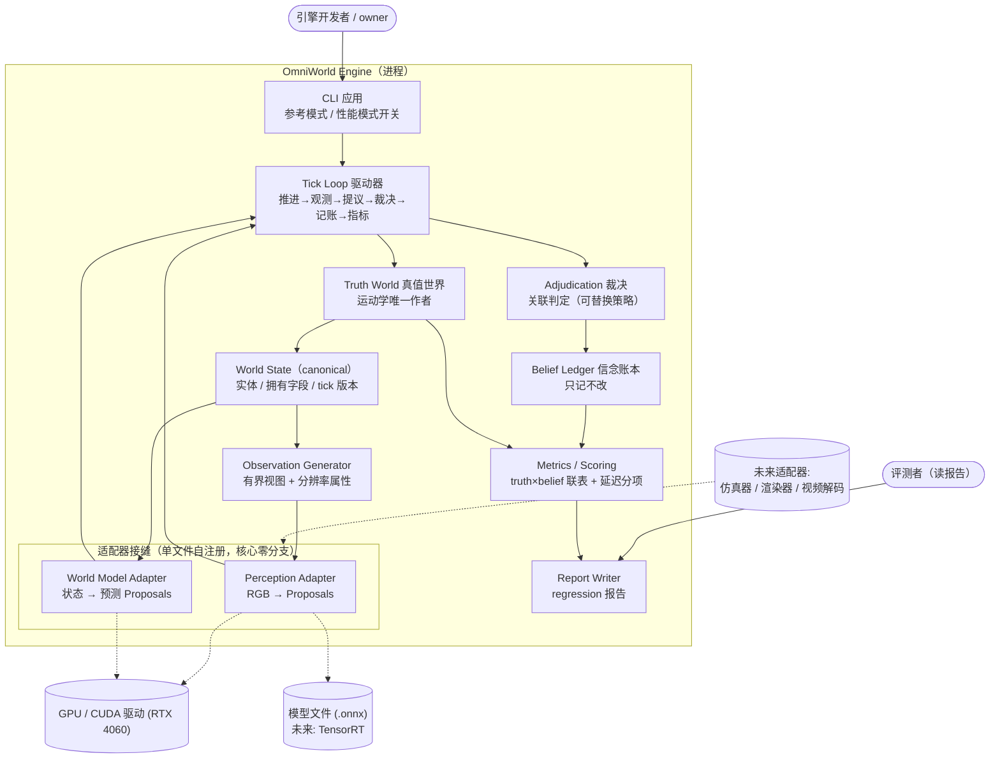
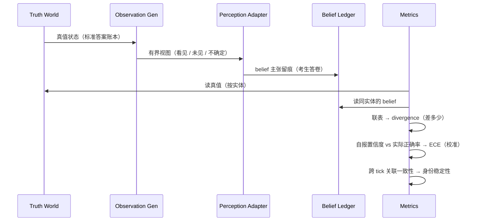

# L0 · 总体设计（总体规划）

> 状态：**草稿——共创中（R1a）**：需求重述（§1）与契约语义（§2）已共创完成，总体架构（§3）与阶段划分表（§4）已定稿待审。**owner 批准后本文整体冻结**，此后变更走 ADR。
> 层级：本文 = L0（总）；`<阶段>/概要设计.md` = L1（分·第一层）；`<阶段>/slices/NN-*.md` = L2（分·第二层）；`problem-log.md` = 横切。
> 模板依据：GB/T 8567《计算机软件文档编制规范》概要设计说明书（裁剪）+ C4 架构分级 + UML；交叉对照 IEEE 1016。每节【规范注解】= 这一步对应规范的哪个环节。
> 后视镜：L0 冻结后对照 v0.1 与 2026-10-09 架构评审洞见做 delta 审查（差异落 ADR）。

---

## 1. 需求重述【规范注解：GB/T 8567 "引言/需求规定"】

（待 owner 审）

**系统定位**（ADR-0008）：GPU 原生世界引擎 + 第一个应用（评测闭环）。

**功能需求 · 引擎本体**：

- **FR1 活世界状态**：维护一个随时间演化的世界状态；实体有身份、读写有时间戳、字段有归属、判断带置信度。
- **FR2 异构接入**：感知模型 / 世界模型 / 仿真器 / 渲染器 / 智能体以适配器形态接入同一状态。
- **FR3 数据可计量**：世界数据在 GPU 系统间流动时，拷贝次数、同步点、逐阶段延迟可测。
- **FR4 可复现**：参考模式逐字节复现；性能模式容差复现 + 延迟预算（ADR-0009）。

**功能需求 · 第一应用（评测闭环）**：

- **FR5 可评分**：真值与各参与者的 belief 可按实体联表评分（divergence / ECE / 身份稳定性）。
- **FR6 适配器不变式**：新参与者接入 = 单文件、核心零改动。

**非功能需求**：参考模式零外部依赖；Windows 本机（RTX 4060 8GB）；单人可维护。

## 2. World Contract 语义设计（白纸共创）【规范注解：数据设计 + 基本设计概念——契约语义是本项目的技术壁垒所在】

> 状态：**8/8 决策点已定（2026-10-12，owner 接受推荐）**；待 L0 整体冻结。冻结后本节为契约权威文本，PLAN §七 将改为指向此处的指针。

**契约速览**：

| 决策点 | 结论（一句话） |
|---|---|
| ① 实体属性 | 最小集 = 位置/朝向/速度/类别；扩展 usage-driven |
| ② 身份 | runtime 唯一铸造（单调 id、不复用）；关联判定可替换 |
| ③ 时间 | 单一 tick 单调时钟域；墙钟仅诊断 |
| ④ 所有权 | 每字段单一作者；v1 真值独占运动学+类别；他人结构性无写接口 |
| ⑤ 写路径 | Proposal 五元组 → 裁决 → 信念账本留痕；真值永不回写 |
| ⑥ 冲突 | v1 只记录、不仲裁；策略族待真实消费者 |
| ⑦ 置信度 | 强制单标量 [0,1]、自报正确概率、零裁决权力、只喂校准 |
| ⑧ 观察 | 有界视图（分辨率属性化）+ 三态可见性（未见 ≠ 空 ≠ 零） |

**逐条语义**：

- **① 实体与属性集（✅）**：最小集 = **位置、朝向、速度、类别标签**；扩展纪律 usage-driven——每字段必须有真实消费者，无消费者的字段不进契约。
- **② 身份铸造与关联（✅）**：runtime 是**唯一铸造者**（id 单调递增、永不复用）；参与者不能自带 id，只能描述特征；"怎么算同一个"（关联判定：匹配到已有 id 或宣布新实体）为**可替换组件**，不焊死在核心。
- **③ 时间域（✅）**：单一 **tick 单调时钟域**，一切读写打 tick 戳；墙钟仅作性能诊断（延迟计量），不参与因果——可复现性的理论地基。
- **④ 字段所有权（✅）**：每个字段类**只有一个作者**；v1 = 真值世界独占运动学（位置/朝向/速度）与类别。其他参与者**结构上无写接口**（非纪律约束）——"数据谁写坏的"永远可回答。
- **⑤ 非拥有者写路径（✅）**：唯一写路径 = **Proposal 五元组**：producer（谁提的）/ tick_observed（哪个瞬间看的）/ target（提给哪个实体）/ fields（主张什么值）/ confidence（几成把握）。runtime 裁决（关联到实体或拒绝）→ **belief 层（信念账本）原样留痕、只被评分、永不反向覆盖真值**。评测 = 真值账与信念账对账。
- **⑥ 冲突策略（✅）**：**v1 只记录、不仲裁**——信念之间不存在覆盖问题（全部留痕、各评各的分）；真值 vs 信念的"冲突"就是指标要测的偏差本身。仲裁策略族（加权 / 置信度竞争 / 时序规则）待真实消费者（如需要单一答案的渲染视图）出现再加。
- **⑦ 置信度语义（✅）**：**强制单一标量 [0,1]**；语义 = 生产者自报的"主张正确概率"；**零裁决权力**（不因把握大而越权，防"无脑报 0.99"刷存在感）；唯一消费者 = **校准指标（ECE）**——说大话的模型会被抓出来。
- **⑧ 观察与部分可见（✅）**：观察 = 某 tick 的**有界视图**（俯视 RGB 图 + 视图元数据：观察者位姿 / tick / 传感器类型）；**分辨率为观察属性，非全局常量**（旧 224 硬编码 bug 从设计上消失）。可见性三态：**看见 / 未见 / 不确定；未见过 ≠ 空值 ≠ 零**——防止模型对未观测区域被迫瞎编。

## 3. 总体架构【规范注解：C4 Container 图（一级 Context 以 §1 定位承担）+ UML 时序图（关键流程）】

### 3.1 容器视图（C4 Container）



### 3.2 关键流程 1：Tick 主循环（世界的每一次心跳）

```mermaid
sequenceDiagram
    participant CLI
    participant Loop as Tick Loop
    participant TW as Truth World
    participant WS as World State
    participant OG as Observation Gen
    participant PA as Perception Adapter
    participant ADJ as Adjudication
    participant BL as Belief Ledger
    participant WA as World Model Adapter
    participant MET as Metrics

    CLI->>Loop: run(seed, ticks)
    loop 每个 tick t
        Loop->>TW: step(t) 推进真值运动学
        TW->>WS: 写入拥有字段（唯一作者）
        Loop->>OG: render(WS, t) 生成有界视图
        OG->>PA: 观察（RGB + 视图元数据 + 三态可见性）
        PA->>Loop: Proposal[]（五元组便签）
        Loop->>ADJ: 裁决：关联实体 / 拒绝
        ADJ->>BL: 留痕（含裁决结果，只记不改）
        Loop->>WA: predict(t) 预测下一状态
        WA->>Loop: Proposal[]（预测便签）
        Loop->>ADJ: 裁决（预测同样走关联 / 拒绝）
        ADJ->>BL: 留痕
        BL->>MET: truth × belief 按 entity_id 联表
        MET->>MET: divergence / ECE / 身份稳定性 / 延迟分项
    end
    Loop->>CLI: 报告数据（性能模式附模式 + 环境元数据）
```

### 3.3 关键流程 2：一张便签的一生（Proposal 裁决链）

```mermaid
sequenceDiagram
    participant P as 参与者（适配器）
    participant Loop as Tick Loop
    participant ADJ as Adjudication
    participant WS as World State
    participant BL as Belief Ledger

    P->>Loop: Proposal{producer, tick_observed, target, fields, confidence}
    Loop->>ADJ: 转交裁决（适配器只出便签，不触核心）
    alt target 是已有实体
        ADJ->>WS: 查询候选实体（位置 / 类别）
        ADJ->>ADJ: 关联判定（可替换策略：最近位置 + 类别）
    else target 声明新实体
        ADJ->>WS: 铸造新 id（runtime 唯一铸造者，永不复用）
    end
    alt 关联成功
        ADJ->>BL: 记录（含"裁决到了哪个实体"这一结果）
    else 无法关联
        ADJ->>BL: 记录拒绝 + 原因
    end
    Note over BL: 真值字段永不回写；<br/>信念之间不仲裁（v1 只记录）
```

### 3.4 关键流程 3：分数从哪来（观测 → 感知 → 指标）



## 4. 阶段划分表（各阶段 目标 · 交付物 · 退出判据）【规范注解：GB/T 8567 "项目开发计划"条目裁剪】

| 阶段 | 目标 | 交付物 | 退出判据 |
|---|---|---|---|
| **A 核心引擎重建** | 白纸重建出可跑的最小闭环：真值世界 → 观察 → 感知参与者在环 → 裁决 → 信念账本 → 指标 | L1 概要设计（模块划分 / UML 类图 / 接口）+ ~6 个 L2 切片 + 实现 + problem-log | **Gate-1 对齐报告**：新实现三判据 vs `pre-rebuild` 基线（1106.7 Hz / 适配器零核心改动 / ECE 判别分离），差异须解释 |
| **B 双模式框架** | ADR-0009 运行层落地 | L1 + L2（双模式 CLI、容差比较器、延迟计量） | 参考模式逐字节不变（ctest 全绿）+ 性能模式容差自证（噪声 stub） |
| **C AI 入环**（旧 Phase 2） | ONNX 真模型（RT-DETRv2-S / Depth-Anything-V2-Small）经同一感知接缝接入 | L1 + L2 + regression 报告 | 真模型单文件接入、核心零改动 + 性能模式延迟预算报告 |

> 每阶段开工前才做该阶段的 L1（不预支）；切片清单由 to-tickets 从 L1 生成。阶段 A 切片草案（R1b 细化）：真值心跳 → 观察生成 → 感知接缝 → 裁决与信念账本 → 指标组 → Gate-1 对齐报告。

## 5. 接口设计总纲【规范注解：GB/T 8567 "接口设计"】

> 待 L1（阶段 A 概要设计）产出：两个适配器接缝的接口签名、CLI 接口、指标层接口。

## 6. 非功能需求细化【规范注解：GB/T 8567 "运行设计/系统出错处理设计"】

> 待 L1：出错信息策略（如性能模式缺依赖时的降级报错）、补救措施、维护性设计。

## 7. 风险登记【规范注解：经典 SE 风险分析；对应旧方向报告 R1-R8 的继承与更新】

> 待 L1（随模块划分细化时评估）。
