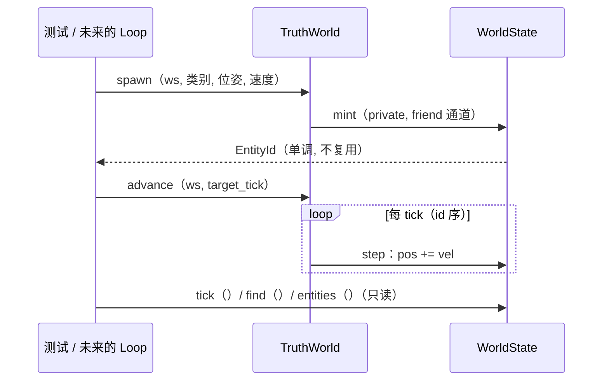

# L2 · 切片 01「真值心跳」详细设计

> 状态：**已按 owner"继续完成目标"指令预授权执行**（2026-10-13）；任何设计点异议 → 修订本文件并记录，语义级变更走 ADR。
> 上承：L1 §4 签名 / §5 切片 01；票据：[.scratch/stage-a-core/issues/01-truth-heartbeat.md](../../../.scratch/stage-a-core/issues/01-truth-heartbeat.md)。
> 模板依据：GB/T 8567 详细设计说明书条目（程序描述 / 数据结构 / 算法 / 流程逻辑 / 接口 / 限制条件 / 测试计划）。

## 1. 程序描述

本切片让世界"活着"：真值世界以 tick 为步长确定性推进 canonical 状态。交付三件事：公共值类型（core/types）、确定性随机源（core/rng）、canonical 状态容器与唯一作者（world_state + truth_world）。

## 2. 数据结构

- `Tick / EntityId` = `uint64_t`；EntityId 从 1 起单调铸造，0 为无效值，永不复用。
- `Vec3 / Quat / Transform`：纯数据（POD）。
- `Visibility`：`enum class : uint8_t { Seen, Unseen, Uncertain }`（本切片定义，切片 02 消费）。
- `Entity`：`{ EntityId id; ClassTag class_tag; Transform transform; Vec3 velocity; }`。
- `WorldState`：私有 `tick_`、`next_id_`、`entities_`（**id 序**，顺序即确定性）；公开只读面 `tick() / size() / find(EntityId) / entities()`。
- `Rng`：splitmix64；`next() → uint64`；`next_unit() = top-24-bits / 2^24 → float [0,1)`（24 位取值对 float 精确可表示）。
- `Hasher`：FNV-1a over raw bytes（确定性测试用）。

## 3. 关键机制

- **单作者（契约④的结构性兑现）**：`WorldState` 的全部变更面（`mint / step / tick_ / next_id_ / entities_`）为 **private**，`friend class TruthWorld` 是**唯一**的编译期通道。"构造注入 Writer 令牌"的形态若将来出现第二写者（需 ADR）再升级；v1 用 friend 是够用且最简的机制。**对 L1 §4 的偏差记录**：L1 草图将 `spawn` 写作 `spawn(tag, transform, velocity)`，遗漏了状态参数——L2 定为最终签名 `spawn(WorldState&, tag, transform, velocity)`（草图级修正，语义不变）。
- **运动学（v1）**：常速直线积分，`dt = 1 tick`；`step()` 按 **id 序**逐实体执行 `pos += vel`（固定运算顺序 = 确定性的一部分）。角速度暂不做（usage-driven：无消费者）。
- **advance(ws, target)**：`while (ws.tick_ < target) ws.step();`；`target < 当前 tick` 为防御性忽略（不崩溃、不改状态）。
- **确定性论证**：顺序标量 float32 运算 + 固定遍历顺序 + 无 fast-math（MSVC 默认 `/fp:precise`）+ splitmix64 无平台依赖；同二进制同输入 → 同输出。测试以"同进程双跑 + 哈希相等"守卫。

## 4. 流程逻辑

## 5. 边界情形

| 情形 | 行为 |
|---|---|
| `advance` 目标 tick 回退 | 防御性忽略（状态不变） |
| `find` 不存在的 id | 返回 `nullptr` |
| 空世界 `step` | 合法（只推进 tick） |
| `spawn` 空类别标签 | 合法（契约不禁止） |

## 6. 测试计划（→ `tests/ow_tests.cpp`，零依赖自检框架）

1. **tick 与积分精确性**：s=42，spawn 速度 (0.25, 0, −0.5)（二进制精确值），advance 到 10 → tick==10，pos == (2.5, 0, −5.0) 精确相等。
2. **确定性**：seed 7 建 8 实体场景推进 100 tick，跑两遍 → 状态哈希完全相等；seed 8 → 哈希不同。
3. **id 铸造**：单调 1,2,3…；0 不出现；find 命中/未命中。
4. **RNG 序列稳定**：同 seed 前 5 值相等；异 seed 首值不同。
5. **只读面**：测试代码除 TruthWorld 通道外**无法**构造任何写操作（编译期事实，走查确认）。

## 7. 与票据验收对照

| 票据 AC | 落点 |
|---|---|
| 逐字节复现 | 测试 2（哈希相等守卫） |
| 无公开写接口 | private + friend 通道（测试 5 编译期事实） |
| core/types 就位 | 本切片产出，切片 02+ 直接消费 |
| 新增测试全绿 | `build.bat --test`（ctest：`ow_slice01`） |
| diff 只触碰声明模块 | 走查：core / world_state / truth_world / tests / CMake |
