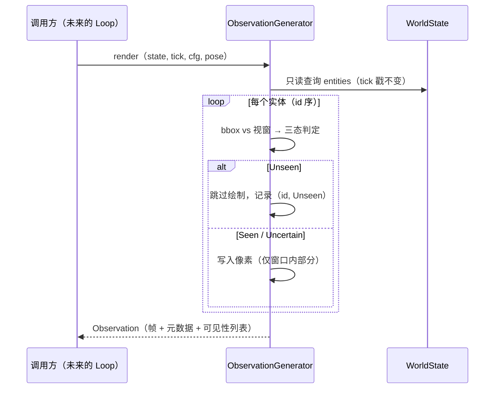

# L2 · 切片 02「观察生成」详细设计

> **设计版本**：v1 · **批准方式**：owner 批准（会话内，2026-10-14） · **批准日期**：2026-10-14
> 状态：**已批准**——G-a 通过，实现进行中（票据置 implementing）
> 上承：[L1 §2 模块论证 / §4 接口签名 / §5 切片 02](../概要设计.md)；契约依据：L0 §2 契约⑧（有界视图 + 三态可见性 + 分辨率属性化）与⑨增补（帧元数据）。前序切片：[01 L2](01-truth-heartbeat.md)。
> 模板依据：GB/T 8567 详细设计说明书（程序描述 / 数据结构 / 关键机制 / 流程逻辑 / 边界情形 / 测试计划）。

## 1. 程序描述

把冻结的世界变成"参与者能看到的东西"：从 WorldState 生成**有界视图**（俯视正交 RGB 图）+ 帧元数据 + 按实体三态可见性。为什么是现在：切片 03 的感知适配器只消费 Observation——没有观察，感知者无米下锅。

本切片同时兑现两个设计级承诺：**分辨率是参数**（旧 224 硬编码 bug 从设计上消灭的实证）、**部分可见是一等公民**（未见 ≠ 空 ≠ 零）。

## 2. 数据结构

- `FrameMeta { std::string backend, device, format; int width, height; }`（L1 §4 原样；参考模式值 = `"cpu"` / `"host"` / `"RGB8"`）。
- `Observation { Tick tick; Transform view_pose; std::string sensor_kind; FrameMeta meta; std::vector<std::uint8_t> rgb; std::vector<std::pair<EntityId, Visibility>> visibility; }`
  - ⚠️ **与 L1 §4 的偏差记录**：L1 草图为 `std::vector<Visibility> visibility;`（与实体顺序隐式耦合）；L2 细化为 `(EntityId, Visibility)` 显式成对——消费者不与实体顺序耦合。草图级修正，语义不变。
- `struct RenderConfig { int width; int height; float footprint; };`：调用方注入（CLI/demo 配置对象）。
  - ⚠️ **与 L1 §4 的偏差记录**：L1 签名 `render(state, tick, width, height, pose)` → 本切片定为 `render(state, tick, cfg, pose)`（cfg 承载 width/height/footprint，便于将来扩展不调签名）。草图级修正，语义不变。
  - **关键约束**：模块内不沉淀任何"默认分辨率"常量；默认值只许存在于**调用方**的配置里（这就消灭了"写死分辨率"这个 bug 类）。
- `class ObservationGenerator { Observation render(const WorldState&, Tick, const RenderConfig&, Transform view_pose); }`（L1 §4 类名保持）。
- 调色板：ClassTag → 颜色由 FNV-1a 哈希派生（复用 `core/hash.hpp`；同类别同色、跨运行恒定）；背景固定深色 `(0x10, 0x14, 0x18)`。

## 3. 关键机制

- **坐标系与投影**：世界平面为 x/z（y 朝上——切片 01 的运动学在 x/z 平面运动），v1 观察者位姿固定为俯视覆盖世界窗口 `[0,1]×[0,1]`（pose 随帧元数据记录，v1 不改变投影——契约⑧允许的唯一第二坐标系）。像素映射：`px = floor(x * width)`、`py = floor(z * height)`；`x == 1.0` 等边界值裁剪到最后一列/行。
- **实体足迹**：轴对齐方块，边长 `cfg.footprint`（世界单位，默认建议 0.02，由调用方配置）；写入 = 覆盖。
- **可见性三态判定（先判后画）**：
  - 实体 bbox 完全出窗口 → **Unseen**（不写像素）；
  - 完全在窗口内 → **Seen**（写像素）；
  - 跨窗口边界（部分可见）→ **Uncertain**（裁剪绘制；被截断的部分正是"不确定"的来源）。
  - v1 不把实体间遮挡计为 Uncertain——俯视重叠是"后 id 覆盖先 id"的确定规则（与 pre-rebuild "later ids overwrite" 先例一致）；遮挡语义升级为"不确定"留给有真实消费者时（usage-driven）。
- **确定性论证**：无 RNG；像素写出顺序 = 实体 id 序（WorldState 顺序恒定）；颜色 = 字符串哈希派生（跨运行恒定）；全部输出由输入函数式决定 ⇒ 同输入逐字节一致。
- **零依赖**：不引图像/颜色库，手写像素写入。
- **元数据如实标注**：FrameMeta = cpu / host / RGB8 / cfg.dims；sensor_kind = `"rgb_topdown"`；tick = 传入值。

## 4. 流程逻辑

## 5. 边界情形

| 情形 | 行为 |
|---|---|
| 空世界 | 全背景色帧 + 空可见性列表（合法） |
| `cfg.width/height ≤ 0` | 抛 `std::invalid_argument`（编程错误，早失败） |
| 实体完全在视窗外 | Unseen，零像素写入 |
| 实体跨视窗边界 | Uncertain，裁剪绘制 |
| 实体坐标恰好 = 1.0 | 视为出窗口（Unseen）；无越界写 |
| 同类多实体 | 同色（调色板按类别哈希） |
| 两实体视窗内重叠 | 后 id 覆盖先 id（确定规则） |

## 6. 测试计划（行为断言 + 确定性断言**成对**——problem-log 002）

1. **分辨率参数化**：一实体位于 (0.5, 0, 0.5)。
   - 8×8：命中像素 (4, 4)，颜色 = palette("blob")；(0,0) 仍为背景色；meta 记录 8×8；
   - 16×16：命中 (8, 8)，meta 16×16。
2. **三态语义**：A(0.5,0,0.5)→Seen；B(2.0,0,2.0)→Unseen 且帧中无 B 的颜色；C(0.995,0,0.5, footprint 0.02) 跨 x=1 边界 → Uncertain 且像素只画窗口内部分。可见性列表为显式 (id, 态) 成对，按 id 序。
3. **确定性**（与 1/2 成对出现）：3 实体固定场景双跑 → `rgb` 逐字节相等 + `visibility` 逐条相等；改 tick 或分辨率 → 输出变化（进展断言）。
4. **边界**：非法分辨率抛异常；空世界合法；pos.x==1.0 不崩溃不越界。
5. **元数据**：backend/device/format/tick/sensor_kind 逐字段断言。
6. **runner 粒度**：ow_tests 改为按 `argv[1]` 分发（`ow_tests slice01` / `ow_tests slice02`）；CMake 注册 `ow_slice02`（`ow_slice01` 改带参注册保持一致）。⚠️ 伴随文件说明：本切片 src/ 只新增 `observation/observation.{hpp,cpp}`；`tests/ow_tests.cpp`、`CMakeLists.txt`、本 L2、票据、`CURRENT.md` 属流程性伴随（切片 01 的 de8d512 先例同样如此），走查时以此为准不判偏差。

## 7. 与票据验收对照

| 票据 AC | 落点 |
|---|---|
| render() 分辨率是参数，无写死常量 | RenderConfig 注入 + 模块内零默认常量；测试 1 以两档分辨率实证 |
| 三态可见性，未见≠空≠零 | §3 判定规则 + 显式成对的可见性列表；测试 2 |
| FrameMeta 携带 backend/device/format/dims（参考模式如实标注） | §2/§3；测试 5 |
| 同 seed 观察序列逐字节一致；非默认分辨率测试通过 | 测试 3（确定性）+ 测试 1（8×8/16×16 均非"旧默认 224"） |
| diff 只触碰 observation 模块 | src/ 限定 `observation/`；伴随文件清单见 §6-6 |
