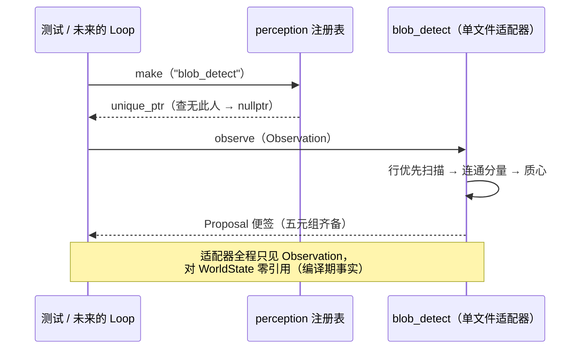

# L2 · 切片 03「感知接缝」详细设计

> **设计版本**：v1 · **批准方式**：预授权（owner「直接把整个切片链实现」指令，2026-10-14；授权范围 = 切片 03–06 全部设计点；偏离即停并回报） · **批准日期**：2026-10-14
> 状态：**已按预授权执行**——票据置 implementing。
> 上承：[L1 §4 签名 / §5 切片 03](../概要设计.md)；契约依据：L0 §2 契约②⑤⑦ + ⑤唯一写路径、⑥不仲裁；FR6 适配器不变式。前序：[01 L2](01-truth-heartbeat.md)、[02 L2](02-observation-generation.md)。

## 1. 程序描述

打通感知参与者的接入缝：**Proposal 类型（契约五元组）+ PerceptionAdapter 接口 + 单文件自注册表 + 两个内置检测器适配器**。adapter 只见 Observation、只出 Proposal；对 WorldState 无任何引用（结构性兑现契约④）。同时为满足切片 05 的 ECE 判别，接缝上现在就挂一对"诚实 / 故意过度自信"检测器。

## 2. 数据结构

- `struct NewEntity {};`——target 的"声明新实体"标记。
- `struct ProposedFields { std::optional<Transform> transform; std::optional<ClassTag> class_tag; };`——**class_tag 可缺省**（见 §3 裁定）。
- `struct Proposal { std::string producer; Tick tick_observed; std::variant<EntityId, NewEntity> target; ProposedFields fields; float confidence; };`（float 置信度强制字面量）
- `validate_proposal(const Proposal&) -> std::optional<std::string>`（core 层 schema 校验：producer 非空、confidence 有限且在 [0,1]、transform 存在性；原因入拒绝记录）——切片 04 消费。
- `PerceptionAdapter { virtual ~; virtual std::vector<Proposal> observe(const Observation&) = 0; virtual const char* name() const = 0; }`。
- 注册表（`perception::reg/make/names`）：name → factory；**`names()` 永远按名字排序**（下一节说明为什么）。
- 背景哨兵色：提升到 `observation.hpp` 公开（`inline constexpr std::uint8_t kBackgroundRgb[3] = {0x10, 0x14, 0x18};`）——观察域的常量，适配器消费。⚠️ 对切片 02 模块头的增量（导出常量，无语义变化），记录于此。

## 3. 关键机制

- **class_tag 缺省裁定（新实体便签的安置）**：感知适配器不臆造类别——检测器只说"这里有个东西"；类别判定/归并交给裁决（切片 04）按位置关联。依据：契约②参与者的本职是描述特征不是宣告身份；usage-driven。
- **确定性**：检测 = 按 (py,px) 行优先扫描、4 连通分量、质心为分量均值——无任何随机性；注册表检索 O(log n) 且不依赖注册顺序。
- **MSVC 静态初始化教训入设计**：跨翻译单元的静态注册**顺序不定**（同一 DLL/链接序）；因此所有枚举都走"按名排序"，注册器本身只插入。ow_core 是 OBJECT 库（预重建已学的 MSVC 教训：静态库会丢自注册对象）。
- **blob 检测（v1）**：行优先扫描帧；非背景像素 4 连通分量；每分量产一张便签：质心映回世界坐标（`x=(mean_px+0.5)/W`、`z=(mean_py+0.5)/H`）、target=NewEntity、无 class_tag。
  - `blob_detect`（诚实）：`confidence = clamp(0.70 + 0.02*面积, 0, 0.95)`——面积越大越有把握，封顶 0.95。
  - `blob_detect_overconfident`（靶机）：恒定 `confidence = 0.99f`——为 ECE 判别注入"说大话"错误置信度。
- **两个适配器 = 两个单文件**（各 40 行内）：第二适配器的存在性检验 = git diff 只多一个文件一行 CMake（FR6/适配器不变式的重建期首证）。

## 4. 流程逻辑

## 5. 边界情形

| 情形 | 行为 |
|---|---|
| 全背景帧 | 返回空便签列表（合法） |
| 未知适配器名 | `make` 返回 nullptr（不误造） |
| 空 producer / 非法 confidence | `validate_proposal` 返回原因（切片 04 用来拒收留痕） |
| 单像素分量 | 合法便签（面积=1，置信度最低档） |
| 相邻异色分量 | 4 连通按"非背景"聚合为一（v1：不做颜色分裂） |

## 6. 测试计划（行为 + 确定性与配对纪律）

1. 注册表：`make("blob_detect")` / `make("blob_detect_overconfident")` 均非空；未知名 → nullptr；`names()` 排序输出。
2. 检测行为：手工构造 8×8 Observation，放 2×2 blob 于 (列2-3, 行4-5) → 恰好一张便签，质心 **x==0.375, z==0.625**（二进制精确），target=NewEntity，无 class_tag，confidence∈(0,1]。
3. 双 blob → 两张便签；producer 名与注册名一致。
4. 置信度对照：同帧 → `blob_detect` 的 max(conf) < 0.99 全部成立，`blob_detect_overconfident` 全部 ==0.99（ECE 判别的种子）。
5. 校验：缺 producer / NaN / 1.5 置信度 → validate 返回原因；合法 → 空。
6. 确定性配对：同帧双跑 → 便签序列逐字节一致；换帧（多一个 blob）→ 不同。
7. 范围：src/ 新增 `core/proposal.hpp`、`perception/`；observation.hpp 增量一个公开常量；伴随 tests/CMakeLists/票据/L2/CURRENT（同切片 01/02 先例）。

## 7. 与票据验收对照

| 票据 AC | 落点 |
|---|---|
| 接口按 L1、适配器拿不到 WorldState | adapter.hpp 只包含 observation/proposal（编译期事实） |
| 单文件自注册 + 核心零逐模型分支 | OW_REGISTER_PERCEPTION 宏 + 注册表唯一分支点 |
| 格式错误拒收 + 原因 | validate_proposal（单测覆盖） |
| 适配器异常不阻断 tick | 切片 06 的 loop 里落地（本切片无 loop；记录在票） |
