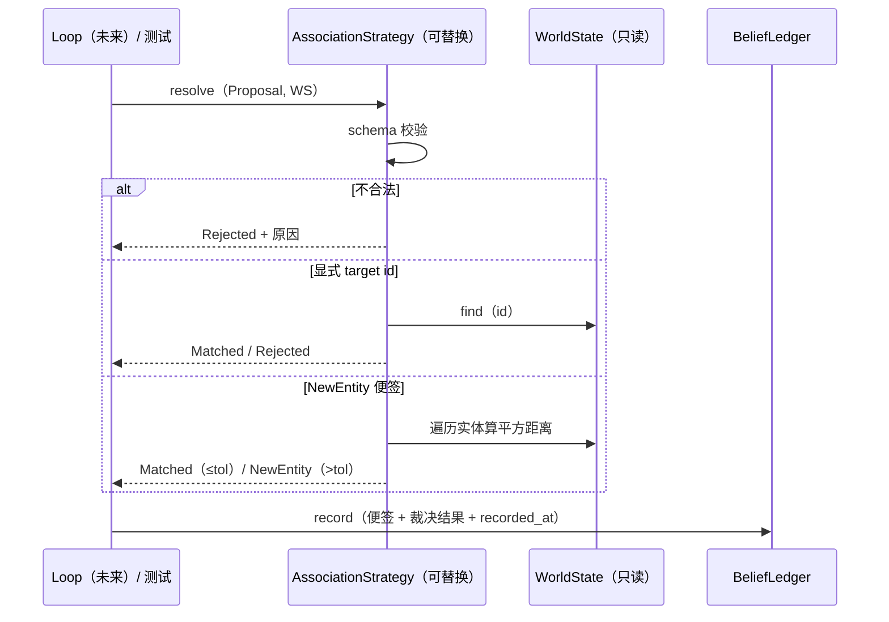

# L2 · 切片 04「裁决与信念账本」详细设计

> **设计版本**：v1 · **批准方式**：预授权（owner「直接把整个切片链实现」指令，2026-10-14；授权范围 = 切片 03–06 全部设计点；偏离即停并回报） · **批准日期**：2026-10-14
> 状态：**已按预授权执行**——票据置 implementing。
> 上承：[L1 §4 签名 / §5 切片 04](../概要设计.md)；契约依据：L0 §2 契约②⑤⑥（写路径/裁决/不仲裁）+ 架构评审洞见 #1（裁决结果携带它裁决的内容）。前序：[03 L2](03-perception-seam.md)。

## 1. 程序描述

便签进 runtime 后，"说的是谁、收不收、记在哪"由本切片回答：`AssociationStrategy`（可替换关联判定，v1 默认 = 位置最近邻）+ `BeliefLedger`（追加式信念账本，裁决结果与便签**一起存**）。

## 2. 数据结构

- `enum class VerdictKind { Matched, NewEntity, Rejected }`。
- `AdjudicationResult { kind; EntityId matched = 0; std::string reason; }`——matched=0 仅出现于 NewEntity/Rejected。
- `BeliefEntry { Proposal proposal; AdjudicationResult verdict; Tick recorded_at; }`（账本条目原样留痕）。
- `BeliefLedger { record(...); all(); at(Tick); }`——只增不改（既有条目的哈希在新条目追加后不变 == 该性质的测试）。

**关键裁定（显性收窄，记录于此）**：NewEntity 判定 = "宣告，不锚定"——matched=0、**不铸造世界 id**。理由：契约④的推论——世界 id 永远且仅由 TruthWorld/WorldState 路径铸造；belief 侧实体只是账本记录，等待真值侧出现后才会被关联。未来若需 belief 侧注册实体，走 ADR 升契约版本。

## 3. 关键机制

- 判定顺序：schema 校验（validate_proposal，切片 03 产出）→ 显式 target id 校验 → NewEntity 便签的位置联想。
- NearestPositionStrategy（默认，tol=0.1，构造参数）：按 x/z 平面**平方距离**最近邻；距离在容差内 → Matched；超出 → NewEntity；无位置主张 → Rejected("no position claim")；多实体等距 → id 序首个（确定性写在规则里）。
- 真值零写入：adjudication 只 `const WorldState&` 读；WorldState 对 TruthWorld 以外无写通道（切片 01 结构性锻件）——测试用"前后哈希相等"作回归守防，而非口头保证。
- 确定性：平方距离 + 固定遍历序 + 等距取先者；无 RNG、无浮点开方。
- 策略替换即架构验收：测试注入一个"永远拒绝"的替身策略验证接缝（策略模式）。

## 4. 流程逻辑

## 5. 边界情形

| 情形 | 行为 |
|---|---|
| 无 transform 的 NewEntity 便签 | Rejected（"no position claim"） |
| 显式 target id 存在 | Matched（v1 不做位置一致性检查——见 ADR 风险 R9 策略族） |
| 显式 target id 不存在 | Rejected（"unknown target id"） |
| 多实体等距 | id 序首个命中（确定） |
| `ledger.at(不存在的 tick)` | 空视图（合法） |
| 非法置信度/空 producer | Rejected 附 validate 原因，不崩溃 |

## 6. 测试计划（行为 + 确定性成对）

1. schema 拒绝带原因（空 producer / 超出 [0,1]）。
2. 显式 target：命中 / 未知 id 拒绝。
3. 位置联想：界内 → Matched（且匹配到正确 id）；界外 → NewEntity（matched=0）。
4. 缺位置主张 → Rejected。
5. 等距平局 → id 序首个。
6. 策略可替换：替身（永远拒绝）注入 → 任何合法便签全部 Rejected（接缝验收）。
7. 真值零写入：裁决前后 `hash_state` 不变（切片 01 的哈希函数复制到本切片命名空间）。
8. 账本：追加顺序保持；at(t) 正确分桶；前缀哈希在追加后不变（append-only 的证明）。
9. 确定性配对：同输入双裁决 → 完全一致的 verdict（kind/matched/reason）。

## 7. 与票据验收对照

| 票据 AC | 落点 |
|---|---|
| 三分支留痕 | 测试 2/3/4 + 账本记录不分支吞并 |
| BeliefEntry 携带裁决结果 | 数据结构（proposal+verdict 同存） + 测试 8 |
| 策略可替换 | 测试 6（替身注入） |
| 真值零写入 | 测试 7（哈希守防）+ 结构性只读引用 |
| v1 单策略、策略族后置 | NearestPosition 仅一实现；R9 持续生效 |
