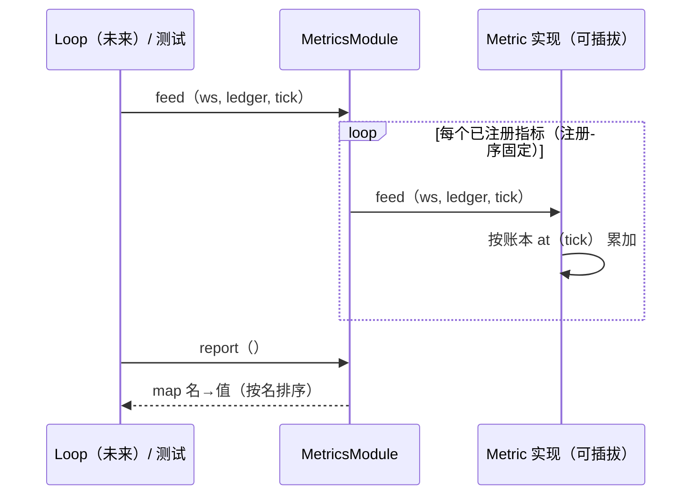

# L2 · 切片 05「指标组」详细设计

> **设计版本**：v1 · **批准方式**：预授权（owner「直接把整个切片链实现」指令，2026-10-14；范围 = 切片 03–06） · **批准日期**：2026-10-14
> 状态：**已按预授权执行**——票据置 implementing。
> 上承：[L1 §2 模块论证（Metrics deep module）/ §4 签名 / §5 切片 05](../概要设计.md)；契约依据：L0 §2 契约⑤⑥⑦（账本为读数源 / 校准指标唯一消费者）；评审候选 #2（指标深模块化）已采纳为本切片的结构。

## 1. 程序描述

把两本账（真值 WorldState、信念账本 BeliefLedger）变成评分：`MetricsModule` 深模块——一个 `feed()` 入口、指标内部可插拔注册；内建 divergence / ECE / 身份稳定性三指标，每 tick 喂一次，随时 `report()`。

## 2. 数据结构

- `Metric` 接口（指标唯一扩展点）：`name() / feed(ws, ledger, tick) / value() -> double`。
- `MetricsModule`：`register_metric(unique_ptr<Metric>)`、`feed(...)` 逐指标转发、`report() -> map<string,double>`（按名排序，确定）。
- 正确性判据常量 `kCorrectTol = 0.1f`（模块私有）：正确 = Matched 且位置误差 ≤ 0.1（v1 固定，usage-driven）。
- 指标状态全部为**按序累加器**（浮点累加顺序固定 = 确定性的一部分）。

## 3. 关键机制

- **divergence**：ledger.at(tick) 中 Matched 且有 transform 的条目：与 WorldState 中 matched id 的真值位姿算欧氏距离（x/z 平面）；全部 tick 上取均值（sum/count，按账本追加顺序累加）。Matched 缺失 → 该 tick 无贡献。
- **ECE**：10 个置信度桶（[0,1] 十等分，端点 1.0 归入末桶）；每桶累计 个数 / 平均置信度 / 实际正确率；ECE = Σ (n_b/N)·|acc_b − conf_b|。Rejected 算不正确。说大话的适配器必然拉大桶内 |acc−conf|。
- **identity_stability**：相邻 tick 的 matched-id 集合（排序后比较）一致性比率：stable_transitions / transitions；首日无转移 → 1.0（v1 声明）。
- **确定性**：整数计数 + 按固定序浮点累加 + 固定 sqrt 次序；无 RNG。
- **深模块验收**：测试自带替身 metric（永远回固定常数）经 `register_metric` 注入并出现在 report——加指标零核心改动。

## 4. 流程逻辑

## 5. 边界情形

| 情形 | 行为 |
|---|---|
| 空账本 | 各指标 report 0（无除零） |
| 全部条目 Rejected | divergence 无贡献；ECE 全部算错（诚实暴露） |
| 单 tick 数据 | identity_stability = 1.0（v1 显式声明） |
| 条目缺 transform | 不计入位置类指标 |
| 置信度恰好 1.0 | 归入末桶（`bin = min(9, floor(c*10))`） |

## 6. 测试计划

1. 深模块冒烟：默认三指标名齐现于 report。
2. **divergence 精确值**：真值 (0.5,0,0.5)：两张 Matched 便签主张 (0.625,·,0.5) 与 (0.75,·,0.5) → err 0.125 / 0.25（二进制精确）→ divergence == **0.1875** 精确相等。
3. **ECE 判别（Gate-1c 同构）**：A 组 8 张便签 conf=0.875，其中 7 张正确（err 0）1 张错（err 0.5）；B 组同错法但 conf=1.0。→ ece_A == 0.0、ece_B == 0.125（全二进制精确），且 B>A。
4. 身份稳定性：相邻 tick matched 集合 {1,2}→{1,2} ⇒ 1.0；{1,2}→{1} ⇒ 0.0。
5. 可插拔：替身 metric 注入 → report 出现其键值（核心零改动，编译期＋行为双重验收）。
6. 确定性配对：同账本同世界喂两遍 → report 值逐字节同；换一轮账本 → 变。
7. 空账本守卫：report 全 0。

## 7. 与票据验收对照

| 票据 AC | 落点 |
|---|---|
| feed 单入口 / report 产出三指标 | 测试 1 |
| 指标内部可插拔注册 | 测试 5 |
| ECE 判别错置信度 | 测试 3（精确分离 0.125） |
| divergence 按 entity 联表 | 测试 2 |
| 逐字节一致 | 测试 6 |
