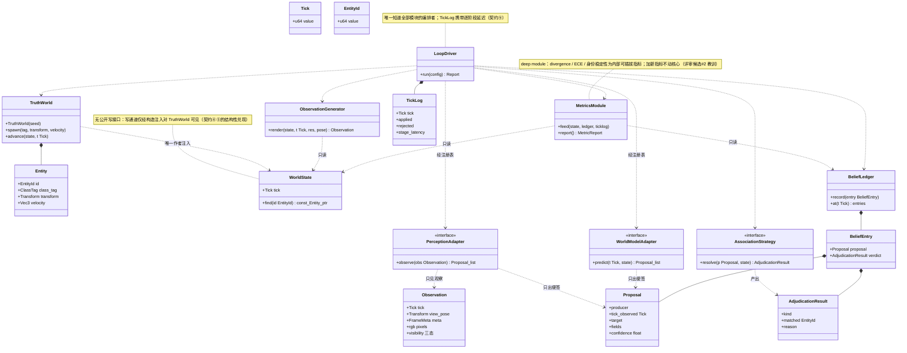

# L1 · 阶段 A「核心引擎重建」概要设计

> 状态：**已冻结（2026-10-13，owner 批准）**；变更走 ADR。
> 上承：[L0](../00-总体设计.md)（已冻结）§3 总体架构 / §4 阶段划分表；下开：各切片详细设计（L2）与 to-tickets。
> 模板依据：GB/T 8567 概要设计说明书（裁剪）+ UML 类图。三项模块决策（10 模块 1:1 / Metrics deep module / 6 切片）owner 已于 2026-10-13 确认。

---

## 1. 本阶段目标与成果

见 L0 §4 阶段 A 行：白纸重建可跑的最小闭环（真值世界 → 观察 → 感知在环 → 裁决 → 信念账本 → 指标），出口 = **Gate-1 对齐报告**（新实现三判据 vs `pre-rebuild` 基线 1106.7 Hz / 适配器零核心改动 / ECE 判别，差异逐条解释）。

## 2. 模块划分与独立性论证（10 模块，与冻结容器图 1:1）

| 模块 | 职责（一句话） | 依赖 | 内聚论证 |
|---|---|---|---|
| `core/types` | Tick / EntityId / Vec3 / Quat / Transform / Visibility 等公共值类型 | 无 | 纯数据，零行为 |
| `world_state` | canonical 状态容器；只读查询；**无公开写接口** | core/types | 只管"状态存在哪" |
| `truth_world` | 确定性运动学推进；WorldState 的**唯一作者**（写通道仅构造注入给它） | core/types, world_state | 只管"世界怎么演化" |
| `observation` | 有界视图生成：分辨率属性 + 三态可见性 + 帧元数据 | core/types, world_state（只读） | 只管"参与者能看见什么" |
| `perception` 接缝 | PerceptionAdapter 接口 + 单文件自注册表 | core/types, observation（只读） | 接入面，单一接缝 |
| `world_model` 接缝 | WorldModelAdapter 接口 + 注册表 | core/types, world_state（只读） | 同上 |
| `adjudication` | 关联判定（**可替换策略**）+ 裁决结果（携带它裁决的内容） | core/types, world_state（只读） | 只管"便签说的是谁" |
| `belief` | 信念账本：裁决后留痕（含拒绝项）、只读查询 | core/types, adjudication（结果类型） | 只管"记什么账" |
| `metrics` | **deep module**：一个入口喂真值+账本+Tick 日志；指标内部可插拔注册 | world_state（只读）, belief（只读） | 只管"分数怎么算" |
| `loop` | 编排一切；Tick 日志（applied/rejected + 逐阶段延迟） | 以上全部 | 只管"按什么顺序发生" |

**耦合论证**：所有跨模块依赖**单向汇入 loop**（编排者）；两个接缝只见观察/只出便签（结构性兑现契约 ④⑤）；observation / adjudication / metrics 对 world_state 只读；依赖图无环。

## 3. UML 类图（细化）



## 4. 接口签名（接缝与核心，C++20 级别）

```cpp
// ---- core/types：公共值类型（纯数据） ----
using EntityId = std::uint64_t;        // runtime 铸造，永不复用
using Tick     = std::uint64_t;        // 单调时钟域；tick 即版本
enum class Visibility : std::uint8_t { Seen, Unseen, Uncertain };   // 三态，未见≠空≠零

// ---- world_state：canonical 状态（只读面） ----
struct Entity { EntityId id; ClassTag class_tag; Transform transform; Vec3 velocity; };
class WorldState {
 public:
  Tick tick() const;
  const Entity* find(EntityId) const;
  // 无任何公开写接口；写通道（内部 Writer）仅经构造注入对 TruthWorld 可见
};

// ---- truth_world：唯一作者 ----
class TruthWorld {
 public:
  explicit TruthWorld(std::uint64_t seed);
  void spawn(ClassTag, Transform, Vec3 velocity);      // 场景搭建期
  void advance(WorldState&, Tick);                    // 确定性推进（唯一写路径）
};

// ---- observation：有界视图 ----
struct FrameMeta { std::string backend, device, format; int width, height; };  // 契约⑧增补
struct Observation {
  Tick tick; Transform view_pose; std::string sensor_kind;
  FrameMeta meta;
  std::vector<std::uint8_t> rgb;                      // W*H*3
  std::vector<Visibility> visibility;                 // 按实体三态
};
class ObservationGenerator {
 public:
  Observation render(const WorldState&, Tick, int width, int height, Transform view_pose);
};

// ---- Proposal：契约五元组（⑤） ----
struct Proposal {
  std::string producer;
  Tick tick_observed;
  std::variant<EntityId, NewEntity> target;           // 已有实体 或 声明新实体
  ProposedFields fields;                              // 主张值（transform / class_tag）
  float confidence;                                   // [0,1]，自报，零裁决权力
};

// ---- 两个接缝（单文件自注册，核心零分支） ----
class PerceptionAdapter {                              // 只见观察、只出便签
 public: virtual ~PerceptionAdapter() = default;
  virtual std::vector<Proposal> observe(const Observation&) = 0;
};
class WorldModelAdapter {
 public: virtual ~WorldModelAdapter() = default;
  virtual std::vector<Proposal> predict(Tick, const WorldState&) = 0;
};
// 各自注册表 + OW_REGISTER_* 宏；注册表查找是核心唯一的接入分支点

// ---- adjudication：可替换关联策略 ----
struct AdjudicationResult { enum { Matched, NewEntity, Rejected } kind;
                            EntityId matched; std::string reason; };   // 携带它裁决的内容
class AssociationStrategy {
 public: virtual ~AssociationStrategy() = default;
  virtual AdjudicationResult resolve(const Proposal&, const WorldState&) = 0;
};

// ---- belief：信念账本（只记不改） ----
struct BeliefEntry { Proposal proposal; AdjudicationResult verdict; };
class BeliefLedger {
 public:
  void record(BeliefEntry);
  std::span<const BeliefEntry> at(Tick) const;
};

// ---- metrics：deep module ----
class MetricsModule {
 public:
  void feed(const WorldState&, const BeliefLedger&, const TickLog&);   // 唯一入口
  MetricReport report() const;
  void register_metric(std::unique_ptr<Metric>);       // 指标可插拔
};

// ---- loop：编排者 ----
struct TickLog { Tick tick; std::size_t applied, rejected; StageLatency latency; };  // 契约⑨
class LoopDriver {
 public:
  RunReport run(const RunConfig&);   // 编排顺序见 L0 §3.2 时序图
};
```

## 5. 切片清单与依赖（6 片，每片 = 完整行为的垂直切片）

| # | 切片 | 打通的行为（验收即行为） | 涉及模块 | Blocked by |
|---|---|---|---|---|
| 01 | 真值心跳 | 一个实体在 tick 推进下确定地动起来；同 seed 逐字节复现 | core/types, truth_world, world_state | 无 |
| 02 | 观察生成 | 任意分辨率的有界视图 + 三态可见性 + 帧元数据 | observation | 01 |
| 03 | 感知接缝 | 内置检测器经单文件自注册入环，只出便签 | perception 接缝 | 02 |
| 04 | 裁决与信念账本 | 便签三分支（关联/新实体/拒绝）全部留痕，真值零写入 | adjudication, belief | 03 |
| 05 | 指标组 | divergence / ECE / 身份稳定性从账本算出，指标可插拔 | metrics | 04 |
| 06 | 世界模型接缝 + Gate-1 对齐报告 | 世界模型过第二接缝；三判据 vs `pre-rebuild` 基线并排，差异解释 | world_model 接缝, loop 完整 | 05 |

每片走「L2 详细设计 → owner 批准 → TDD → problem-log → 走查」；L2 批准是动工的硬 gate（PLAN 规则 #6）。

## 6. 非功能需求细化（阶段 A 适用部分）

- **确定性**：参考模式同 seed 同输入逐字节复现；浮点纪律沿用 `pre-rebuild` 已验证的编译选项（见风险 R8）。
- **语言与编译器策略**：C++20（2020 年标准，2026 年已主流；本机 MSVC 19.29 上一实现已实证可构建逐字节复现产物）。特性纪律 = **"boring core"**：只用主流稳定特性（concepts / std::span / std::variant / designated initializers / constexpr 增强）；**不用** modules 与 coroutines（工具链支持参差、本项目无消费者——usage-driven 同样适用于语言特性）。GPU 前瞻：阶段 C 起 `.cu` 设备端代码遵循更保守子集（NVCC 对新标准支持滞后），宿主端不受影响。
- **依赖**：零外部依赖（阶段 A 全部参考模式，纯 CPU）。
- **出错处理**：格式错误便签 → 拒收 + 原因留痕（不崩溃）；关联失败 → 拒绝（非异常）；适配器异常隔离（单个适配器抛异常不得阻断 tick 推进——**建议级**，L2-03 落实）。
- **延迟计量**：TickLog 结构在 loop 落地（契约⑨）；其消费（性能判据）属阶段 B。

## 7. 风险登记（阶段 A 视角；L0 §7 的 R1—R6 继续有效）

| # | 风险 | 缓解 |
|---|---|---|
| R7 | L1 签名在 L2/实现中暴露不合理之处 | 修订即走 ADR（设计文档变更纪律），禁止静默改 |
| R8 | MSVC 浮点优化破坏逐字节复现 | 固定浮点编译选项（沿用 pre-rebuild 验证过的配置）；一旦出现跨运行漂移立即记 problem-log |
| R9 | 关联策略过度设计 | v1 只做"最近位置 + 类别匹配"一种策略；策略族后置（usage-driven） |

## 8. 架构风格与设计模式对照【规范注解：GB/T 8567 "基本设计概念"；术语出处：GoF《设计模式》、Ousterhout《软件设计哲学》（deep module）、Cockburn 端口与适配器】

**纪律：模式是需求的结论，不是目标。** 每一项均可追溯到具体需求编号；"为未来灵活性"预置的抽象层（事件总线、抽象工厂塔、无消费者的接口层级）一律不进——usage-driven 覆盖。

| 采用 | 名称 | 需求出处（为什么用它） |
|---|---|---|
| 架构风格 | **端口与适配器**（Hexagonal，Cockburn） | FR2/FR6：异构参与者接入，且新参与者 = 单文件零核心改动。"接缝"即端口，"适配器"即实现——核心与外界的隔离是项目立身之本 |
| 架构风格 | **管线 / 数据流**（pipes & filters） | tick 主循环的固定编排（L0 §3.2）：FR3 要求逐阶段延迟可计量，阶段边界必须清晰 |
| 架构风格 | **单一作者 + 追加式账本** | 契约④⑤：评测完整性 = 真值唯一作者；belief 账本只追加不修改，指标是账本的投影 |
| 设计模式 | **策略**（Strategy，GoF） | 契约②："怎么算同一个"是会进化的研究问题——算法必须可替换而不动核心 |
| 设计模式 | **注册表 + 自注册**（Registry） | FR6 的机制基础：单文件自注册实现适配器不变式；注册表查找是核心唯一的接入分支点 |
| 设计模式 | **深模块**（Deep Module，Ousterhout） | 评审候选#2 教训：指标可扩展但不碰核心——一个 `feed()` 入口把 N 个指标的计算关在门后 |
| 设计模式 | **值对象 / 只读数据**（Value Object） | Observation / Proposal 为纯数据、WorldState 只读面——契约④"结构性无写接口"的类型层兑现 |
