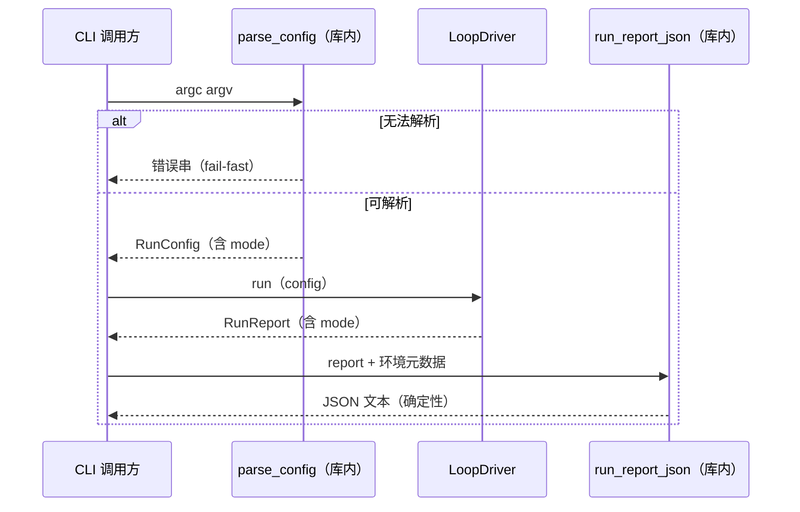

# L2 · 切片 B1「双模式 CLI + 工件 schema」详细设计

> **设计版本**：v1 · **批准方式**：预授权（owner「推送吧，然后继续开发」指令，2026-10-16；授权范围 = 切片 B1 全部设计点；偏离即停并回报） · **批准日期**：2026-10-16
> 状态：**已按预授权执行**——票据置 implementing。
> 上承：[L1 §4 签名](../概要设计.md)（`RunMode` / 工件写入口单一 / 无默认值纪律）；契约依据：ADR-0009（模式开关 + 报告标注）；票据：[.scratch/stage-b-dual-mode/issues/01-dual-mode-cli-artifact-schema.md](../../../../../.scratch/stage-b-dual-mode/issues/01-dual-mode-cli-artifact-schema.md)。

## 1. 程序描述

把 ADR-0009 的“模式开关”接到 CLI 与工件上：`--mode reference|performance`（默认 reference），run report 的 JSON 工件带 `mode` 字段 + 环境元数据。**v1 性能模式 = 与参考模式同一条代码路径**（尚无真实 GPU 组件），如实标注 `acceleration: none`——不假装 GPU（L1 风险 R-B2）。

## 2. 数据结构

- `enum class RunMode { Reference, Performance };`（`loop/driver.hpp`；RunConfig 新增 `mode` 字段，**无默认值**）。
- `struct EnvironmentMeta { os, arch, compiler, build, git_commit, cpp_standard, cpu_logical_cores, acceleration };`——采集于**编译期 + 运行时可得**信息，逐字段标注来源；CPU 只取逻辑核数（std::thread::hardware_concurrency），GPU 不在参考模式声称。
- `RunReport` 新增 `mode` 字段（既有字段不变）。
- JSON 工件 schema（`run_report_json()`）：`{config:{...}, environment:{...}, metrics:{...}, world_hash, ledger_hash, ledger_entries, applied, announced, rejected, adapter_faults, mode}`——逐字段按 `std::map`/固定序输出（确定性：两次调用字节一致）。

## 3. 关键机制

- **CLI 解析可测**：解析逻辑从 `main()` 下沉为库内纯函数 `parse_config(argc, argv) -> std::variant<RunConfig, std::string>`（错误串即未知选项/未知模式的 fail-fast 消息）。
- **JSON 写入口单一**：runner（apps）只调 `run_report_json()`；环境元数据采集在库内完成（宏：`_WIN32` / `_MSC_VER` / `_DEBUG` / `__cplusplus` / `_M_X64`；commit 经 CMake `OW_GIT_COMMIT` 注入）——Markdown 报告层引用同一 JSON 值。
- **模式同路径**：B1 阶段两种 mode 走同一 run；工件以 `mode` 字段区分；`acceleration` 字段如实标 `none`（B3/B4 起才出现差异行为）。
- **确定性**：JSON 不含墙钟/随机字段；整数与哈希以十进制字符串输出。

## 4. 流程逻辑

## 5. 边界情形

| 情形 | 行为 |
|---|---|
| 未知 mode 值 | 错误串（列出合法值），退出码非 0 |
| 未知 CLI 选项 | 错误串（含合法选项清单） |
| mode 缺省 | `parse_config` 填 Reference（CLI 默认层——L1 §6 无默认值纪律的唯一允许处） |
| ticks/宽度等缺省 | 同样只在 CLI 默认层填（apps 的 main 保持当前默认集合） |
| 同一 report 两次序列化 | JSON 字节一致（确定性断言） |

## 6. 测试计划（slice07，行为 + 确定性成对）

1. **解析行为**：无参 → Reference；`--mode performance` → Performance；`--mode bogus` → 错误串；`--ticks 100` → ticks==100；未知选项 → 错误串。
2. **JSON 模式标注**：Reference 运行产物含 `"mode":"reference"`；Performance 产物含 `"mode":"performance"` 且 `acceleration"` 为 `none`。
3. **同路径一致性**：同配置两种 mode 运行 → `world_hash`/`ledger_hash` 逐位相等（v1 声明行为）。
4. **确定性配对**：同一 RunReport 两次 `run_report_json()` → 字节相等（JSON 无墙钟字段）。
5. **环境元数据在场**：JSON 含 os/arch/compiler/build/commit/cpu 字段键（非空值，除 commit 可能为空串的构建）。
6. **参考模式回归**：全量 ctest 7/7 不变绿。

## 7. 与票据验收对照

| 票据 AC | 落点 |
|---|---|
| `--mode` 默认 reference、未知 fail-fast | 测试 1 |
| JSON 含 mode + 环境元数据，Markdown 层引用单一写入口 | 测试 2/5 + apps 只调 `run_report_json()` |
| 参考模式 ctest 逐字节复现 | 测试 3/6（双跑哈希一致） |
| performance v1 = 同路径 + 如实标注 | 测试 2/3 + `acceleration:"none"` |
| diff 范围 = apps/ + loop 增补 + tests/CMake | 走查时对照 L1 §5 B1 行 |
