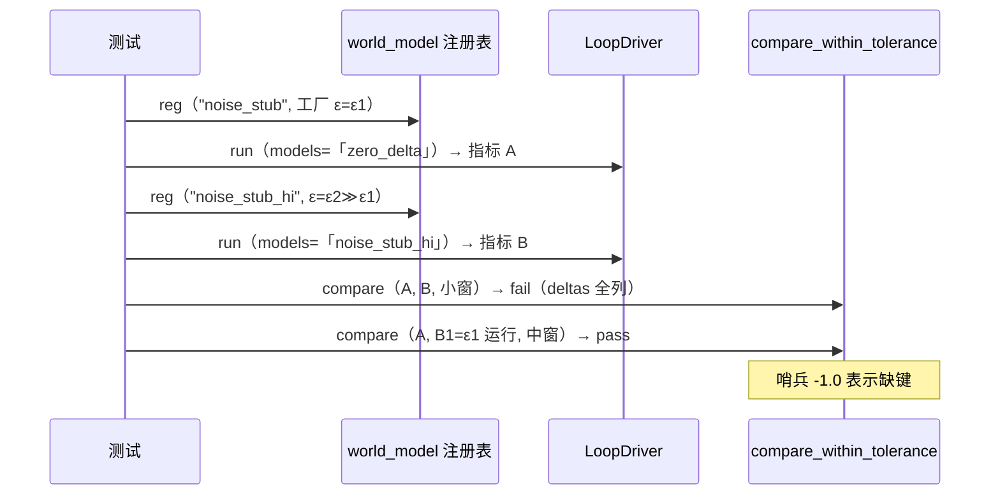

# L2 · 切片 B2「容差比较器 + 噪声 stub 自证」详细设计

> **设计版本**：v1 · **批准方式**：预授权（owner「推送吧，然后继续开发」指令，2026-10-16；授权范围 = 切片 B1–B5 全部设计点；偏离即停并回报） · **批准日期**：2026-10-16
> 状态：**已按预授权执行**——票据置 implementing。
> 上承：[L1 §4 签名](../概要设计.md)（`src/tolerance/` 为 loop 私有子件、纯数据进纯数据出）；契约依据：ADR-0009（容差复现机制）；票据：[02-tolerance-comparator-noise-stub.md](../../../../../.scratch/stage-b-dual-mode/issues/02-tolerance-comparator-noise-stub.md)。

## 1. 程序描述

阶段 B 出口判据「性能模式容差自证（噪声 stub）」的**机制**：容差比较器（两组指标 map + 每指标容差窗口进、判定与全部差值出）+ 一个参数化噪声幅度的**测试替身**世界模型适配器，双向自证：窗内过、超窗红。

## 2. 数据结构

```cpp
struct ToleranceWindow { std::string metric; double abs_tol; };  // 窗口键支持分解键（如 "ece:<producer>"——B4 预留）
struct ToleranceVerdict {
  bool pass;
  std::vector<std::pair<std::string, double>> deltas;  // 全部被比较键的 |a-b|（不只第一个失败者）
};
ToleranceVerdict compare_within_tolerance(const std::map<std::string, double>& a,
                                          const std::map<std::string, double>& b,
                                          const std::vector<ToleranceWindow>& windows);
```

- **缺键口径（本切片裁定）**：窗口键在任一侧缺失 → 该键 delta = `-1.0`（哨兵值，语义 = “未比较：缺键”）且判红。哨兵而非异常：判定本身是纯数据操作，缺键是数据问题不是程序错误。
- **未列入窗口的键**不比较。
- `pass` = 每个被比较键都存在且 |差| ≤ 窗。

## 3. 关键机制

- 比较器是 `src/tolerance/` 内**无状态函数**：无 I/O、无时钟、无 RNG——确定性由构造保证。
- 暴声 stub 是**测试替身**（先例 slice04 `AlwaysReject` / slice06 `ThrowingPerception`；测试内注册、不进 `src/`）：世界模型适配器，`predict` 返回每实体位置 + 参数化 ε（x 轴偏移）。
- 为什么 stub 落在世界模型接缝（而非感知）：世界模型**看得到 canonical 状态**、输出逐实体预测，最容易注入可控扰动且可经裁决入账本——噪声直接进入指标流。
- 与 run-report 的关系：比较器输入是两次运行的 `metrics` map（B1 的 JSON 工件已含该 map）——机制上即刻可判读两份工件。

## 4. 流程逻辑



## 5. 边界情形

| 情形 | 行为 |
|---|---|
| 窗口键缺失（任一侧） | delta = -1.0，pass = false |
| 空 windows | pass = true（无可比对象——调用方责任） |
| 重复键窗口 | 后者覆盖（map 语义，文档化） |
| 差值恰等于窗口 | 判过（≤ 含等号） |
| NaN 指标值 | NaN 比较为 false → 该键自然失败（无需特判） |

## 6. 测试计划（slice08，行为 + 确定性成对）

1. **比较器纯函数行为**：已知 map 对 + 窗口 → deltas 精确值（二进制可精确的小构造）；恰等窗口 → 过；缺键 → 哨兵 -1.0 且判红；空 windows → 过。
2. **stub 注册与参数化**：`noise_stub` 注册后 `world_model::make` 可得；不同 ε 注册不同名，行为随 ε 变化。
3. **自证·窗内方向**：基线运行（models 空，纯感知驱动）vs ε 小噪声运行 → 指定窗口内 `compare_within_tolerance` 判 **pass**（窗口值由一次实测校准后写入，含余量标注）。
4. **自证·超窗方向**：同基线 vs ε 大噪声运行 → 同窗口判 **fail** 且 deltas 非空、窗口外键的 delta 值 > 窗口（判定可读，不只布尔）。
5. **确定性配对**：同一次比较两次执行 → verdict 逐字段一致；同 ε 两次运行 → 指标 map 相等（loop 侧确定性回归）。
6. **全量回归**：ctest 8→9 项全绿。

## 7. 与票据验收对照

| 票据 AC | 落点 |
|---|---|
| 比较器接口（全部差值输出） | §2/§3 + 测试 1 |
| 窗口键支持分解键 | `ToleranceWindow.metric` 为任意字符串键（B4 直接可用） |
| stub 测试替身、参数化 | 测试 2；不进 `src/`（走查确认 diff 无 src/ 新增参与者） |
| 双向自证（窗内过/超窗红） | 测试 3/4 |
| 零外部依赖 | 无新依赖；比较器纯 std |
