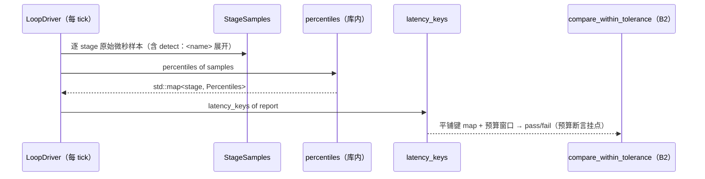

# L2 · 切片 B3「延迟计量 + 分位数下沉」详细设计

> **设计版本**：v1 · **批准方式**：预授权（owner「推送吧，然后继续开发」指令，2026-10-16；授权范围 = 切片 B1–B5；偏离即停并回报） · **批准日期**：2026-10-16
> 状态：**已按预授权执行**——票据置 implementing。
> 上承：[L1 §4 签名](../概要设计.md)（`StageSamples` / `percentiles()` / 分位数下沉 + 预算断言挂点）；票据：[03-latency-percentiles.md](../../../.scratch/stage-b-dual-mode/issues/03-latency-percentiles.md)。

## 1. 程序描述

把逐 stage 计时的**原始微秒样本**在库内保存（保真），把 p50/p95 的**计算下沉进库**（口径 = pre-rebuild runner：排序后线性插值）供程序化判读；TickLog 结构不变、RunReport 增样本与分位数字段；JSON 工件呈现逐 stage p50/p95；预算断言挂点 = `latency_keys()` 平铺键 + B2 比较器。

## 2. 数据结构

- `using StageSamples = std::map<std::string, std::vector<double>>;`——stage 键集合：`truth_step` / `render` / `detect:<适配器名>` / `predict:<模型名>` / `adjudicate` / `metrics`。
  ⚠️ **口径偏离（显式记录）**：pre-rebuild 的旧表有每适配器 `adjudicate:<name>` 键；本实现把裁决并为单一 `adjudicate` 段（编排只有一个裁决循环）。**分位数口径沿用旧 runner**（排序后线性插值），stage 键集合为新——因键集合变而引起的比较差异如实标注。
- `struct Percentiles { double p50; double p95; };`
- `std::map<std::string, Percentiles> percentiles(const StageSamples&);`
- `std::map<std::string, double> latency_keys(const RunReport&);`——平铺为 `"<stage>.p50"` / `"<stage>.p95"` 键，供 `ToleranceWindow` 承载延迟预算（B2 比较器直接消费）。
- `RunReport` 新增 `stage_samples`、`stage_percentiles`（既有字段与哈希**零改动**——样本/分位数不进任何哈希）。

## 3. 关键机制

- **插桩粒度**：每 tick 对 truth_step / render / 每个 `detect:<name>` / 每个 `predict:<name>` / adjudicate / metrics 分别计时（微秒、steady_clock）；既有 `StageLatency` 四段汇总从样本派生（truth+render→render_ms；detect:+predict:→perceive_ms），不重复插桩。
- **percentile 口径**（与旧 runner 一致）：排序副本 → `rank = q*(n-1)`，`lo=floor(rank)`，`v[lo] + (rank-lo)*(v[lo+1]-v[lo])`；n=1 → 原值；空 → 0。std::map 输出 → 键序确定。
- **墙钟永不进哈希**：现有 `hash_world`/`hash_ledger` 不触及任何计时字段（B1 已证参考模式零行为变化——B3 后再证一次）。
- **JSON 呈现**：`stage_percentiles` 嵌套对象（stage → {p50, p95}）；原始样本不进 JSON（大且诊断性；库内与测试可取）。

## 4. 流程逻辑

## 5. 边界情形

| 情形 | 行为 |
|---|---|
| 0 ticks 运行 | 样本为空、分位数为 0、latency_keys 为空、比较器缺键哨兵 |
| 单 tick | 分位数 = 该 tick 原值（口径 n=1 分支） |
| 阶段无样本（适配器未启用） | 键不存在（而非 0 值）——缺键由 B2 哨兵语义处理 |
| 过快的 stage（如 8 实体单步 advance） | 可在计时器分辨率下记 0.0μs（实测：p50 常为 0）——预算窗口按重 stage（render/感知）设定；0.0μs 是计时事实不是缺陷 |
| 恰等于预算窗口 | 判过（≤ 含等号，B2 口径沿用） |

## 6. 测试计划（slice09，行为 + 确定性成对）

1. **分位数口径**：样本 1..10 → p50 == 5.5、p95 == 同表达式（9.0 + (0.95×9−8)×(10−9)）；单元素 → 原值；空 → 0。
2. **样本键集合与计数**：20 tick 运行（1 感知 + 1 世界模型）→ 六个键齐现且每个样本数 == ticks；stage_percentiles 键集合同步。
3. **预算断言挂点**：`latency_keys` 平铺键存在；同报告自比（窗 = 值）→ pass；零窗（且该值 > 0，先断言）→ fail；缺键 → 哨兵 -1.0 判红。
4. **JSON 呈现**：run_report_json 含 `stage_percentiles`、`"p50"`、`"render"`。
5. **墙钟回归**：同配置双跑 → world_hash / ledger_hash 逐位一致（计时插桩不泄漏进哈希）。
6. **确定性配对**：同报告两次序列化字节一致（分位数存于 report、不重算）。

## 7. 与票据验收对照

| 票据 AC | 落点 |
|---|---|
| 逐 stage 原始样本由 loop 保存 | 测试 2（键含 detect:<name> 展开） |
| 库内 p50/p95 接口 | 测试 1（口径精确值） |
| TickLog/report 呈现逐 stage p50/p95 | 测试 2/4 |
| 预算断言挂点 | 测试 3（latency_keys + B2 比较器） |
| 墙钟不进哈希 | 测试 5 |
| 参考模式逐字节不变 | 测试 5/6 + 既有 slice07 基线断言 |
