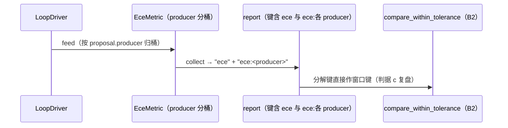

# L2 · 切片 B4「per-producer ECE（F1）」详细设计

> **设计版本**：v1 · **批准方式**：预授权（owner「推送吧，然后继续开发」指令，2026-10-16；授权范围 = 切片 B1–B5；偏离即停并回报） · **批准日期**：2026-10-16
> 状态：**已按预授权执行**——票据置 implementing。
> 上承：[L1 §3 Metrics 行 / §4 键约定](../概要设计.md)（聚合键 `"ece"` + 分解键 `"ece:<producer>"`）；教训：problem-log 005 + 手册反模式 #13。契约⑦：置信度唯一消费者 = ECE。票据：[04-per-producer-ece.md](../../../../../.scratch/stage-b-dual-mode/issues/04-per-producer-ece.md)。

## 1. 程序描述

对齐报告 F1 的兑现：ECE 指标**按 producer 分桶**，report 与 JSON 工件同时给出聚合键与分解键；然后用对齐场景（2026-10-14 报告同参数）重测，**如实分析**判据 (c) 的在环可判性。

## 2. 数据结构

- `Metric` 接口新增默认实现 `collect(std::map<std::string,double>&)`（默认行为 = 单键 `name()` = `value()`）；需要分解视图的指标覆写——接口扩展不破坏既有指标。
- `EceMetric` 内部：`std::map<std::string, std::array<Bin,10>> bins_`——producer → 10 桶；feed 时按 `proposal.producer` 自动建行。
- **聚合恒等式（测试断言）**：聚合 `"ece"` = 全池合并（所有 producer 的所有桶）的加权公式 = 各 producer ECE 按条目数的加权平均——测试用精确值验证该恒等。

## 3. 关键机制

- 分解键名 `"ece:" + producer`（与 L1 §4 约定一致；容差窗口可直接按此键声明，B2 比较器无需改动）。
- `MetricsModule::report()` 改为遍历 `collect()`——map 键序保证确定性。
- JSON 工件（B1）自动携带分解键——无 runner 层改动。
- 判据 (c) 复盘口径：沿用 Round 1 #2 的旧判据（good = 正确 id 且误差 ≤ 0.05；Gate 1c 分离线 ≥ 0.30），测出多少报多少——**不许为了让数字好看而调判据**。

## 4. 流程逻辑

## 5. 边界情形

| 情形 | 行为 |
|---|---|
| 无账本条目 | `"ece"` = 0，**无**分解键（缺键由 B2 哨兵语义接管） |
| 新 producer 第一次出现 | 自动建行（map 自动扩容） |
| 某 producer 条目全被拒 | 该 producer 仍计 n（Rejected 判错）——分解视图如实反映 |
| 置信度恰为 1.0 | 归入末桶（bin = min(9, floor(c*10))，既有口径） |

## 6. 测试计划（slice10，行为 + 确定性成对）

1. **分解精确值（单测）**：两个 producer、相同正误结构、不同自报置信度（0.875 vs 1.0）→ `"ece:honest"` == 0.0、`"ece:loud"` == 0.125、聚合 == 0.0625（等条目数加权平均，恒等式）。
2. **在环分离（双检测器默认场景）**：`"ece:blob_detect"` 显著高于 `"ece:blob_detect_overconfident"`（诚实组欠自信 vs 夸大组；余量 ≥ 0.05 的稳健断言）。
3. **聚合居中**：min(分解值) ≤ "ece" ≤ max(分解值)。
4. **确定性配对**：同场景两次运行 → 含分解键的 metrics map 完全相等。
5. **对齐场景重测（判据 c 复盘）**：600 tick / seed 42 默认配置 → 分离量与旧阈值 0.30 的比较，**如实记入 problem-log**（达标或未达标都给数）。

## 7. 与票据验收对照

| 票据 AC | 落点 |
|---|---|
| ECE 按 producer 分桶 | 测试 1/2 |
| report 聚合 + 分解同层 | 测试 1/3 |
| 精确分离单测 | 测试 1（沿用 slice05 的二进制精确法） |
| 对齐重测 + 如实分析 | 测试 5（problem-log 006） |
| 聚合+分解一致性 | 测试 3（恒等式） |
