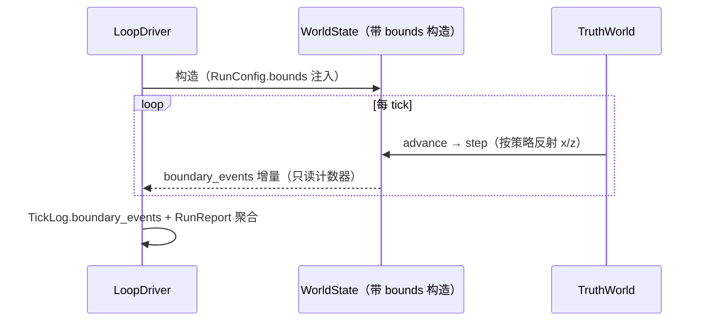

# L2 · 切片 B5「有界场景（F2）」详细设计

> **设计版本**：v1 · **批准方式**：预授权（owner「推送吧，然后继续开发」指令，2026-10-16；授权范围 = 切片 B1–B5；偏离即停并回报） · **批准日期**：2026-10-16
> 状态：**已按预授权执行**——票据置 implementing。
> 上承：[L1 §4 签名 / Round 2 裁决](../概要设计.md)（`bounds(none|wall)` 构造注入、常数边距 0.02、step() 内落点、clamp/不变式测试、边界事件进 TickLog）；契约⑨ 追加字段注释（L0 §2 已同步）。票据：[05-bounded-scene.md](../../../.scratch/stage-b-dual-mode/issues/05-bounded-scene.md)。

## 1. 程序描述

给真值世界一个有界场景策略：`none`（现状行为，逐字节不变）或 `wall`（x/z 轴镜像反射 + 速度取反），构造注入到 `WorldState`；边界事件计数进 TickLog 与 RunReport；随后按 problem-log 006 的承诺**在墙场景重测判据 (c)**。

## 2. 数据结构

- `struct BoundsPolicy { enum class Kind { None, Wall }; Kind kind; float margin; };`——**定义在 `core/types.hpp`**（world_state 与 loop 共享；见下方偏差 1）。
- `WorldState`：构造参数 `explicit WorldState(BoundsPolicy)`；`step()` 内按策略反射（x/z 两轴各至多一次）；公开只读累加器 `boundary_events()`。
- `TickLog` 与 `RunReport` 各增 `boundary_events` 计数（契约⑨ 追加字段，既有字段零改动）。
- `RunConfig.bounds` 无成员默认值；CLI 层填 `none` / `--bounds wall --margin F`（默认 0.02；wall 要求 0 < margin < 0.5，否则 fail-fast）。

## 3. 关键机制

- **反射语义（x/z 轴）**：`pos += vel` 后，越界则 `pos = wall - (pos - wall)` 且 `vel = -vel`（镜像反射）；**单次反射后仍在界外**（极端速度）→ 钳制到墙并已计一次事件（无循环 clamp、无死迭代）。
- **单轴单 tick 至多一次反射**：由 if/else-if 结构保证；不变式测试守护。
- **确定性**：纯浮点算术、零 RNG、按 id 序遍历——同 seed 位级可复现。
- **`none` 模式 = 现行为逐字节不变**（用 2026-10-14 对齐基线哈希字面量断言）。
- **写面不扩张**：反射在 `step()` 内，TruthWorld 调用面零改；WorldState 公开面只增量一个只读计数器。

## 4. 流程逻辑

## 5. 边界情形

| 情形 | 行为 |
|---|---|
| margin ≥ 0.5（域退化） | CLI 层 fail-fast（拒绝构造病态场景） |
| 速度 > 2×域宽 | 单次反射 + 钳制到墙（计 1 次事件），速度已取反 |
| 恰在墙上 | 反射公式保持界内或贴墙（浮点闭包由钳制保证） |
| none 模式 | 零反射、零事件、哈希与基线逐位一致 |
| y 轴 | 不反射（竖直方向，与 slice01 运动学语义一致） |

## 6. 测试计划（slice11，行为 + 确定性成对）

1. **none 基线**：600/42 默认配置 none 模式 → `world_hash == 574361e62eec92b9` / `ledger_hash == 459ff85132cc103e` / `boundary_events == 0`。
2. **有界性**：wall 模式 200 tick 后所有实体 x/z ∈ [margin, 1-margin]；`boundary_events > 0`。
3. **精确反射**：pos=0.95、vel=0.05、margin=0.02 → 一步后位置 = 同表达式反射值、速度取反、事件 == 1。
4. **极端速度钳制**：vel=2.5 不越界死循环、仍钳回界内、事件 ≥ 1。
5. **确定性 + JSON**：wall 模式同 seed 双跑 → 全部哈希/指标相等；JSON 含 bounds=wall 与 boundary_events；none vs wall 哈希不同（物理不同）。
6. **CLI 解析**：`--bounds wall --margin 0.02` 解析；非法 margin / 未知 kind fail-fast。
7. **判据 (c) 墙场景重测**（problem-log 006 闭环）：对齐参数改 wall → per-producer ECE 分离量，如实记入 problem-log 007。

## 7. 与票据验收对照

| 票据 AC | 落点 |
|---|---|
| RunConfig.bounds 无默认值 + 构造注入 | §2 + 测试 6 |
| none 逐字节不变（基线哈希字面量） | 测试 1 |
| wall 镜像反射 + 常数边距 0.02 + 零 RNG | §3 + 测试 2/3 |
| 不变式：单轴单 tick 恰一次反射 | 测试 3/4 |
| TickLog.boundary_events（契约⑨ 追加） | §2 + 测试 1/5 |
| 墙场景重测供 F1 读数 | 测试 7（problem-log 007） |

## 偏差记录（对 L1 §4 草图的实装级修正，语义不变）

1. **`BoundsPolicy` 定义位置**：L1 §4 草图将其列于 `loop/driver.hpp`——那会造成 `world_state → loop` 的反向依赖（依赖图成环）。实装移至 `core/types.hpp`（共享值类型层）。
2. **`WorldState` 不提供默认构造**：L1 §4 只声明 `explicit WorldState(BoundsPolicy)`——保持唯一注入路径；tests 中既有 19 处 `WorldState ws;` 统一改为显式传 `None`（ Mechanical 更新，无语义变化）。
3. **margin 默认值所在层**：`--margin` 缺省 0.02 只存在于 CLI 解析层（与 L1 §6 无默认值纪律一致）。
