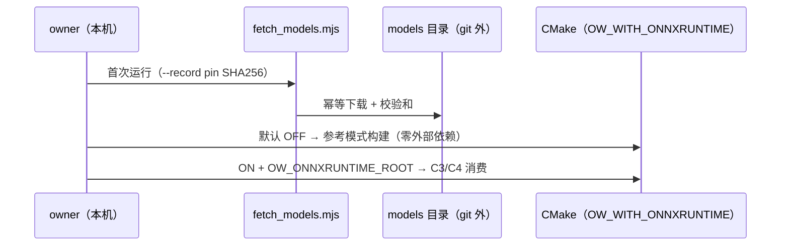

# L2 · 切片 C1「依赖隔离 + provider 框架」详细设计

> **设计版本**：v1 · **批准方式**：预授权（owner「推送吧，然后继续开发」指令链，2026-10-16；授权范围 = 阶段 C 各切片设计点；偏离即停并回报） · **批准日期**：2026-10-16
> 状态：**已按预授权执行**——票据置 implementing。
> 上承：[L1 §3 构建层 / §4 签名](../概要设计.md)（`OW_WITH_ONNXRUNTIME` 默认 OFF；ORT 仅链入性能路径）；票据：[01-ort-dependency-isolation.md](../../../.scratch/stage-c-ai-in-loop/issues/01-ort-dependency-isolation.md)。
> 模板依据：GB/T 8567 详细设计说明书条目 + Mermaid（禁 ASCII 括号于消息文本）。

## 1. 程序描述

把 ORT 这个第一个外部依赖"关起来"：默认构建零外部依赖不变（参考模式的构建级证明）+ 研究 note 把所有选型事实钉在一手来源上 + 模型文件获取脚本 + `--ep` 参数骨架（cuda 的实现随 C3）。

## 2. 数据结构

- `enum class ExecProvider { CpuEp, CudaEp };`（`loop/driver.hpp`；TrtEp 按 L1 Round 1 #2 预留，**本切片不加入**——研究 note 已记录其 ABI/open issue 风险）
- `RunConfig.ep`（无默认值；CLI 层填 cpu）
- CMake `option(OW_WITH_ONNXRUNTIME ... OFF)` + 编译定义 `OW_WITH_ONNXRUNTIME=0/1`
- `tools/fetch_models.mjs` + manifest（URL / 体积 / 许可 / SHA256 槽位）

## 3. 关键机制

- **默认 OFF**：`build.bat --test` 行为零变化——零外部依赖不变式是**构建级**断言（不是注释）。
- **ON 时的约定**：`OW_ONNXRUNTIME_ROOT` 指向解压的 ORT GPU zip；仅 C3/C4 的适配器文件消费该定义；核心模块零 include。
- **研究 note 落地策略**：一手来源 + 检索日期 + UNVERIFIED 标注；对本机适配（CUDA 12.6.20 / cuDNN 现状）给出**决策路径**而非猜测结论。
- **模型获取**：不进 git；fetch 脚本幂等 + SHA256 首跑 pin 定（`--record` 模式）。

## 4. 流程逻辑

## 5. 边界情形

| 情形 | 行为 |
|---|---|
| 重复运行 fetch | 幂等（已存在且校验和一致则跳过） |
| 模型 URL 失效 | 脚本非零退出 + manifest 记录备用源（Kaggle 导出路径） |
| `--ep cuda` 但 ORT 未启用 | C1 阶段允许解析（骨架）；C3 落地时 fail-fast 报错（依赖缺席） |
| ONNX Runtime 版本漂移 | manifest 与 note 记录 pin 定策略；C3 首个消费票复核 |

## 6. 测试计划（slice15，行为断言）

1. **解析行为**：`--ep cpu|cuda` 解析；缺省 cpu；`--ep bogus` 错误串。
2. **构建级不变式（走查项）**：默认 `cmake` 配置产物不引 ORT（`grep` 或构建日志佐证）+ `OW_WITH_ONNXRUNTIME` 选项存在且默认 OFF。
3. **fetch 脚本静态检查**：manifest 字段齐（URL/size/license/sha256 槽位）、幂等分支存在、`--record` 写入路径明确。

## 7. 与票据验收对照

| 票据 AC | 落点 |
|---|---|
| research note（ORT/TRT/模型/许可/体积） | `docs/17-research/2026-10-16-onnx-runtime-integration.md` |
| fetch_models + SHA256 + 许可记录 | `tools/fetch_models.mjs` |
| CMake 选项默认 OFF、默认构建零依赖 | CMakeLists + 走查项 2 |
| ORT 路径约定文档化（供 C3/C4） | 本 L2 §3 + research note |
| `--ep cpu` CLI 参数 | driver.hpp/cpp + 测试 1 |

## 偏差记录

无（L1 §4 签名在本切片只落 EnumProvider/RunConfig.ep 两处；TrtEp 按 L1 预留裁定不实现）。
