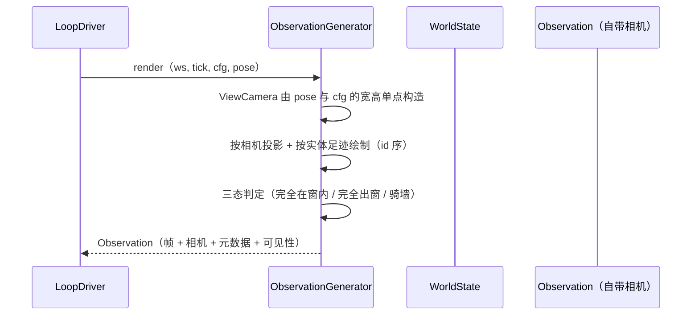

# L2 · 切片 C2「Observation 多分辨率 + Camera 合并」详细设计

> **设计版本**：v1 · **批准方式**：预授权（owner「推送吧，然后继续开发」指令链延展，2026-10-16；授权范围 = 阶段 C 各切片设计点；偏离即停并回报） · **批准日期**：2026-10-16
> 状态：**已按预授权执行**——票据置 implementing。
> 上承：[L1 §4 Observation 签名](../概要设计.md)（"Camera 并入后：观察自带相机与分辨率"）+ L2 C1；票据：[02-observation-multi-resolution-camera.md](../../../.scratch/stage-c-ai-in-loop/issues/02-observation-multi-resolution-camera.md)。
> 模板依据：GB/T 8567 详细设计说明书条目 + Mermaid（禁 ASCII 括号于消息文本）。

## 1. 程序描述

候选 #3 的收尾：观察**自带相机与分辨率**——Camera（投影角色）并入 Observation；模型要求的分辨率（RT-DETRv2-S 640×640 / DA-V2-Small ~518×518）作为 Observation 属性经 render() 产出。这不是新特性，是把已存在的参数化事实**收拢为显式契约**——为 C3/C4 的真模型扫清最后的概念债。

## 2. 数据结构

```cpp
// 并入后：观察 = 帧 + 相机（位姿 + 投影职责）+ 元数据 + 可见性
struct ViewCamera {          // 由 TopDownCamera 的投影职责归位而来
  Transform pose;           // 观察者位姿（契约⑧ 的第二坐标系）
  int width;                // 像素宽（本观察的分辨率，属性而非常量）
  int height;
  // 投影：world <-> pixel（俯视 [0,1]^2 平面；y 朝上）
  Vec2 pixel_from_world(Vec3 w) const;   // 世界坐标 → 像素坐标
  Vec3 world_from_pixel(int px, int py) const;
};
struct Observation {
  Tick tick = 0;
  ViewCamera view;           // ← 相机并入：观察自带"怎么看"
  std::string sensor_kind = "rgb_topdown";
  FrameMeta meta;            // backend/device/format/dims 与 view 一致（dims 引用 view 尺寸）
  std::vector<std::uint8_t> rgb;
  std::vector<std::pair<EntityId, Visibility>> visibility;
};
// RenderConfig 保持：调用方显式构造（无默认值纪律不变）
struct RenderConfig { int width; int height; float footprint; };
```

- **RenderConfig 与 ViewCamera 的关系**：RenderConfig 是"渲染请求"，ViewCamera 是"产出的观察所携带的相机"——前者是入参，后者是 observation 的属性；dims 一致性由构造时单点建立（见 §3）。

## 3. 关键机制

- **单点一致性**：`render()` 内构造 `ViewCamera{pose, cfg.width, cfg.height}`，FrameMeta 的 dims 直接引用同一对值——分辨率不可能"元数据说一套、像素说一套"。
- **投影职责迁移**：原 `TopDownCamera` 的自由函数并入 `ViewCamera` 成员函数（语义等价，逐位保持）；`world_from_pixel` 的钳制逻辑随迁（边界表已覆盖）。
- **像素原点/朝向不变**：row-major、top-left 原点、俯视 y-up——现有所有测试的逐位断言继续成立。
- **无默认值纪律**：RenderConfig 无默认成员（阶段 A slice 02 确立）；ViewCamera 由 render() 单点构造。

## 4. 流程逻辑



## 5. 边界情形

| 情形 | 行为 |
|---|---|
| 分辨率 0 或负 | 既有非正值守卫抛错（slice 02） |
| 恰好模型分辨率（640×640 / 518×518） | 普通参数路径——无分支、无魔法分支 |
| 分辨率与 footprint 组合 | 仅影响绘制几何，不影响相机归属 |
| 元数据 dims 与像素缓冲尺寸 | 构造时单点赋值，不可能不一致 |

## 6. 测试计划（slice12，行为 + 确定性成对）

1. **相机并入**：Observation.view 携带 pose + 分辨率；`pixel_from_world` 与 `world_from_pixel` 互逆（同一相机下往返一致）。
2. **多分辨率渲染**：32×32 / 64×64 / 640×640 / 518×518 四种分辨率渲染成功且像素缓冲尺寸正确；同世界不同分辨率的实体像素位置随比例映射（抽查一实体在两分辨率下的像素坐标比例关系）。
3. **基准不变**：600/42 默认场景 → `world_hash == 574361e62eec92b9` / `ledger_hash == 459ff85132cc103e`（字面量断言——Camera 并入不改变任何观测字节）。
4. **三态与可见性**：单分辨率 + 多分辨率下的三态判定一致（三态是几何谓词，与分辨率无关）。
5. **确定性配对**：同输入双渲染 → 字节相等（含相机字段）。

## 7. 与票据验收对照

| 票据 AC | 落点 |
|---|---|
| Camera 并入 Observation | §2 + 测试 1 |
| render() 按模型分辨率产出 + 元数据如实 | 测试 2 |
| 600/42 参考哈希字面量不变 | 测试 3 |
| slice12：多分辨率 + 三态 + 确定性 | 测试 2/4/5 |
| L1 §4 签名同步 + PLAN 候选标记 | 本 L2 落盘即 L1 §4 的 Observation 段落地（契约⑧ 注释已在 L0 §2） |

## 偏差记录

无（L1 §4 的 Observation 草图在本切片逐字落地；`TopDownCamera` 退场为内部实现细节——若有第三方引用再议，本仓无）。
